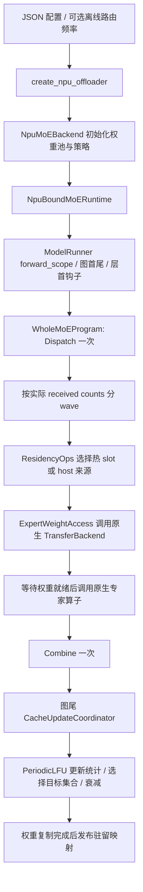

# MoE Cache 与框架适配

本文描述当前原生 Ascend 路径上的 cache 和框架接线。2026-10-22 的重构基于
`faa807f`，统一使用原生后端，移除早期通用 cache 后端及其重复的 runtime、驻留表和算子适配。
本次只收敛我们负责的部分；ACL/MemFabric 搬运、原生权重格式和 prefill 流水实现保持不变。

## 1. 当前调用链



框架负责阶段、调用顺序和设备状态的生命周期；LFU 负责选出下一轮热专家集合；
`ResidencyOps` 与权重访问层负责将这个集合落实成搬运和发布操作。

保留现有 `WholeMoEProgram`、`ResidencyOps` 和传输协议，不再增加一套兼容后端。
生产入口支持 DeepSeek V4 + Ascend + DeepEP；decode 要求完整图，prefill 使用 eager 流水。
verify/speculative 仍未接入，删除的旧 runtime 所提供的 eager decode 路径不属于当前原生能力。

## 2. 缓存数据模型

每个 EP rank 独立维护本 rank 所有可卸载层的专家目录。`(layer_id, expert_id)`
在目录中展开成 canonical key。不同层的同号专家是不同 key；离线文件采用全局 expert ID，
dispatch 后采用该层本地专家编号，目录负责两者转换。

| 存储或状态 | 作用 |
| --- | --- |
| Host store | 完整只读专家 bundle，含权重及 scale；淘汰不需要写回 |
| Hot pool | 跨 decode forward 保留热专家，prefill 可借用 |
| Execution banks | 当前 wave 的连续算子输入；读者完成后才可覆盖 |
| `key_to_slot` / `slot_to_key` / `slot_valid` | 唯一驻留映射及可读状态，由现有 residency 维护 |
| `step_access_count` / `update_enabled` | 本 forward 的有效 assignment 数及统计门控 |
| `usage` / `step_mod` / `update_due` | LFU 热度、周期位置和本轮是否应替换 |
| `CacheRouteStats` | 固定地址的 accesses、hits、misses 三个标量 |

命中从 hot pool **D2D** 到 execution bank，未命中从 host **H2D** 到该 bank。
当前原生算子使用连续 bank，不直接计算离散热 slot。miss 按需计算与热缓存准入是两件事：
本步用过一个专家不代表立即把它变成热专家。

## 3. LFU 规则与本次简化

当前五项行为：

1. **初始化**：本 rank 按 layer_id 顺序，每轮给每个可卸载层分配一个 slot，直到用满容量；
   专家已全部装入的层不再分配。无统计文件时，各层按 expert ID 顺序选专家；有文件时改为
   层内频率 Top-K，同频按 ID 排序。统计不会改变层间配额。容量不少于可卸载层数时，每层
   至少一个 slot；容量更小时，先分给 layer_id 较小的层。启动阶段装入完整 bundle 后发布
   映射，在线 usage 从零开始，不依赖空缓存逐步填充。
2. **在线计数**：使用 dispatch 后有效 assignment counts。重复路由逐次计数，hit/miss 都计入；
   padding、无效 token 不计入，不将 counts 展开成逐 token Python 列表。
3. **周期替换**：每 4 个有效完整 decode forward 调整一次。每层内部将最热的非驻留专家
   与最冷的驻留专家配对，候选 usage ≥ 2，候选减被替换者 usage ≥ 1.5。
   1.5 是加性差值，不是倍率。不同层不互相淘汰，因此在线每层配额不变。
4. **限额与遗忘**：各层候选按热度差统一排序，本 rank 每轮最多替换 96 个，随后全部 usage × 0.7。
   不满足替换条件的周期也执行衰减。
5. **复制与发布分离**：策略只产生目标集合，驻留层保留原有等待与发布顺序。
   正在被计算读取的 bank 先等读者完成，新 bundle 复制完成后才可发布映射。

本次将逐层的 gain/valid 计算合并到候选拼接之后，并利用现有 key→slot 映射构造 K 长度的
目标集合。最终排序由全部 E 个专家缩为 K 个缓存条目；每层冷热排序和 rank 级候选排序仍然存在。
使用整数 scatter 写入 key，key+1 编码区分专家 0 与空 slot；空位最终输出为 -1。

这不是改成全局 Top-K，也没有改变层内配对、阈值、周期、平局顺序或输出协议。
`select_hot_set` 仍返回按 key 排序的集合，不指定物理 slot；内部借助旧 slot 计算集合不意味着
residency 必须按相同 slot 落位。现有 residency 决定最终搬运和 slot 分配。

图中每步发出固定形状的运算，通过设备 `update_due` 控制是否真正替换；不会在 Python 中读取
设备热度来决定分支。capture/warmup 与 prefill 不推进周期，全局空步不推进周期；
若全局有工作而本 rank 没有路由，本 rank 仍推进周期，与其他 rank 保持 forward 节奏一致。

### 启动配置

`offline_stats_path` 默认为空，示例 `npu/examples/v4.json` 可直接开启 0.25 热缓存，无需
事先统计。可选文件只需 `{"layers":{"3":{"0":120,"1":80}}}`，expert ID 使用全局编号，
缺少的频次按零处理。启用热缓存时，显式提供的文件不存在、格式错误或频次非法仍报错。

`offline_model_id` 不必填写，文件也不必包含 `model_id`。旧配置若显式填写此项，仍与文件
标签比较；这只是用户指定的标签校验，不代表验证了实际模型权重的身份。

本次只改变启动选集与配置要求，不改变 `ResidencyOps`、`WholeMoEProgram`、transferOps、
bank 布局、H2D/D2D 等待及发布接口。默认周期和在线层内替换规则保持不变。

## 4. Prefill / decode 的接线

### Decode

1. `forward_scope` 结合全局 `is_extend_in_batch` 选择阶段：Attention-DP 中只要有 rank
   在 prefill，本地 decode/idle rank 也使用 prefill 路径。普通 decode 根据 batch
   是否有全局工作设置设备统计开关。
2. 图首清理本步计数；每层 Dispatch 一次，按收到的专家需求执行多个固定 wave，再 Combine 一次。
3. 每个 wave 记录真实 assignment 数和命中数；空 lane 不触发有效搬运或计算。
4. 图尾调用 `CacheUpdateCoordinator`，更新 usage，选目标集合，完成周期衰减，再提交驻留更新。
5. replay 执行图中已有节点；Python `forward_scope` 不再次更新 LFU，避免一个 batch 计数两次。
6. eager/replay 返回前，在 compute stream 上回读一次 `error_status` 标量。权重搬运和
   发布的依赖已汇入该流；非零状态抛出异常，owner 进入 FAILED，拒绝后续 forward。
   此检查位于图外，独立于日志开关；会增加一次标量回读的主机等待，不新增整卡同步。

`ModelRunner` 保留统一 forward scope、capture 和层首入口，移除只服务旧 eager runtime 的
`eager_step_scope` 透传。统计门控由原生 runtime 的固定地址设备状态负责，不再传第二个 `adjust` 开关。

### Warmup 与捕获资源

同一组图首/图尾钩子也会被 NPU graph backend 的 warmup 调用。`GraphLeaseBackend`
在每次 warmup 及原有 reset hook 完成后调用 `after_graph_warmup()`：等待全部设备流，
再通过 `release_completed()` 清理上下文的资源、完成票据及循环引用。同步失败时继续
保留资源，交给原有失败清理。真正 capture 的上下文仍由 graph 持有；正常 replay 不新增整卡同步。

Decode 每层及每个 wave 使用 `temporary_scope()`。FFN 的跨流读者汇入 compute stream、
wave 结果写回后释放该 wave 的临时引用；Combine 后释放该层的接收张量和通信 handle 引用，
让 graph allocator 能复用中间存储。事件和 transfer ticket 继续保留至完成或 graph 销毁，
失败提交的资源保留至 drain。Prefill 仍沿用整次 invocation 的资源生命周期。

FFN 对自己产生的输出原地清零无效行，wave 写回使用 `torch.where(..., out=layout.output)`，
减少完整接收容量的中间输出。这些修改不改变 LFU 或缓存容量；真实 NPU 的内存峰值及完整
模型 replay 仍需验证，CPU 生命周期测试不能证明目标模型已经消除 OOM。

### Prefill 与恢复

1. 从 decode 切入 prefill 时，通过现有 `DecodeStateSnapshot` 保存驻留信息及 LFU 周期状态。
2. prefill 借用热池空间，按原生流水分组加载专家；层首钩子建立跨层读者完成约束。
3. prefill 不更新 LFU。切回 decode 时按快照原 slot 从 host 回填完整权重并恢复状态。
4. 后续 decode 继续原来的 usage 和周期位置，不把 prefill 当作一次 decode。

无需额外 `CacheMetadataAdapter` 快照。仍保留实际恢复所必需的快照、事件与 graph 地址生命周期。

## 5. 代码职责与移除项

| 文件 | 当前职责 |
| --- | --- |
| `periodic_lfu.py` | 按层初始化及可选离线排序、在线计数、层内配对、rank 限额与衰减 |
| `cache_metadata.py` | 仅保留 `CacheRouteStats`，消费现有计数与命中 mask |
| `execution.py` | 原有程序编排及唯一的 `CacheUpdateCoordinator` 图尾入口 |
| `npu/backend.py`、`npu/runtime.py` | 唯一生产组装、钩子、阶段和 capture/replay 生命周期 |
| `npu/experts.py` | 原生 dispatch 布局、bank 视图及专家算子接线 |
| `residency.py` | 现有唯一驻留表、计划和发布实现 |

删除 `cache_backend.py`、`cache_runtime.py`、`cache_residency.py`、`ascend_adapter.py`、
`model_binding.py`，同时删除其导出和旧 eager hook。它们提供的通用组装及适配已有原生路径承担。
直接导入这些旧内部类的开发脚本需要迁移；生产 JSON 入口不变。

本次未把目标集合协议改成直接替换对，未改热池/执行池关系，也未压缩原生传输或 prefill 调度。
因此这是完整 3–4k 目标的第一步，不代表整个 MoE offload 已达到该代码量。

## 6. 验证

本次将旧后端测试迁到当前生产调用链，仅对设备、传输和专家计算使用 CPU 测试实现。
测试不会给生产代码增加 CPU fallback。

| 测试文件 | 覆盖 |
| --- | --- |
| `test_periodic_lfu.py` | 默认规则、随机参考结果对照、空/满容量、空洞/乱序 slot、无 host 热度回读 |
| `test_cache_metadata.py` | 多 wave 计数、开关、空输入、固定统计地址 |
| `test_cache_runtime.py` | 层首和 V4 直接入口、FusedMoE 转发、ModelRunner eager/graph 分支、capture 门控 |
| `test_cache_model_binding.py` | 原生 DeepEP 布局、动态 counts、padding、原生 bank 视图与错误屏蔽 |
| `test_cache_integration.py` | 一次 Dispatch/Combine、多 wave、LFU 周期、等待复制后发布、prefill 回填 |
| 现有 native/framework/residency/graph 测试 | 原生组装、租约、生命周期及驻留计划回归 |

2026-10-22：Windows CPU 环境运行上述及相关目录的 12 个测试模块，**129 项通过**。
未执行未修改的 POSIX 启动脚本测试 `test_launch_moe_offload_npu.py`（11 项）。
未在本轮执行真实 NPU/H2D/D2D 或完整模型推理；CPU 图相关测试验证的是捕获接线和张量依赖，
不能替代 NPU graph replay 验证。

同日初始化修正后，CPU 回归为 **150 项通过、无 skip**，含无 profile 的实际原生装配调用链、
在线替换与回填，以及启动脚本 Python 配置检查。Bash 语法检查通过；POSIX 整套启动测试与
真实 NPU 推理仍需在目标环境执行。

设备故障传播、全局 prefill 阶段及字节打包修正后，CPU 回归为 **157 项通过、无 skip**。
字节打包仅在清零时使用 INT8 view，避开 Ascend masked_fill_ 不支持 UINT8 的限制；
保留原始位模式和缓冲地址。CPU 测试覆盖该 dtype 限制、输入/scale 缓冲及 padding 清零。

同步同事 `81e49613` 的生命周期修复，统一使用 warmup 完成钩子，移除旧的流状态查询和
图尾自动释放实现。新增 CPU 检查覆盖 40 层多 wave 临时张量释放、空/部分 wave、
FFN 输出原地清零、多图 bucket 的 warmup 清理，以及同步失败时保活。
整合后的统一 CPU 回归为 **169 项通过、无 skip**；本轮未执行真实 NPU 测试。

在有 PyTorch 的环境可运行同一组 CPU 测试：

```bash
python - <<'PY'
import pathlib
import sys
import types
import unittest
root = pathlib.Path.cwd()
pkg = types.ModuleType('sglang')
pkg.__path__ = [str(root / 'python/sglang')]
sys.modules['sglang'] = pkg
folder = root / 'test/registered/unit/offloading'
sys.path.insert(0, str(folder))
names = sorted(p.stem for p in folder.glob('test_*.py')
               if p.stem != 'test_launch_moe_offload_npu')
result = unittest.TextTestRunner(verbosity=2).run(
    unittest.defaultTestLoader.loadTestsFromNames(names))
raise SystemExit(not result.wasSuccessful())
PY
```

原生启动配置、profile 格式和 NPU 环境验证入口见
[周期缓存接入原生后端](npu/doc/PERIODIC_CACHE_1022.zh-CN.md)及其链接的运行说明。

在已具备 PyTorch / torch_npu 的 NPU 环境，直接执行一条命令，自动运行 CPU 回归和
真实 NPU LFU/统计、字节打包和 capture 生命周期验证，并将日志和 JSON 报告保存到当前目录的 `moe-cache-validation/`：

```bash
python test/manual/validate_moe_cache_refactor.py
```

默认使用逻辑 NPU 0。只有需要单独运行 CPU 回归时才传 `--cpu-only`：

```bash
python test/manual/validate_moe_cache_refactor.py --cpu-only
```

退出码 0 表示所选阶段全部通过且无 skip；失败返回非零。`report.json` 记录提交、各阶段结果和
未覆盖项，`cpu.log` / `npu_lfu_graph.log` / `npu_layout_graph.log` / `npu_capture_lifetime.log`
保存详细日志。默认模式下，缺少 torch_npu、
无设备或图捕获失败都算失败，不回退 CPU。NPU 阶段验证动态 counts、周期与衰减、统计门控、
热集合变化、空洞 slot 和固定状态地址；用测试映射模拟发布，不宣称验证了真实权重搬运。
字节打包阶段调用真实 `_gather_bytes`，检查动态 count/index、有效字节、padding 及地址稳定性；
不运行完整专家 FFN，也不能替代模型推理验证。本地未执行新增的 NPU 阶段。

`npu_capture_lifetime` 使用真实 NPU 流、事件和 NPUGraph 调用生产 runtime 的首尾钩子，
检查每次 `after_graph_warmup()` 后临时 Tensor 释放、capture 后保活以及修改输入后的 replay 正确性；
不调用 MemFabric 或专家 kernel，也不证明完整 TP8 模型已无 OOM。
