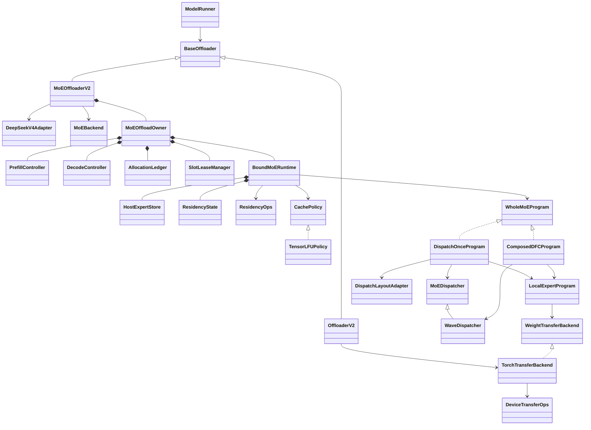

# MoE offload framework

> **2026-10-21 implementation update:** tensor cache planning, bounded prefill,
> native ACL submission, shared MemFabric/ACL host storage, V4 FP4 loading,
> runtime hooks and DeepEP/Ascend bank execution are implemented.
> See [startup and runtime](../npu/doc/README.zh-CN.md), [native ACL](../npu/native/doc/README.zh-CN.md),
> [weight storage](../npu/doc/V4_STORAGE.md), [EP/FFN](../npu/doc/EXPERTS_IMPLEMENTATION.zh-CN.md)
> and [local validation](LOCAL_VALIDATION_1021.zh-CN.md).
> Target A5/CANN compilation, numerical parity, full graph and performance acceptance
> remain unverified. CPU test sources and emulation paths have been removed.

English | [中文](README.zh-CN.md)

[Three-person development plan (Chinese)](DEVELOPMENT_PLAN.zh-CN.md)

The parent `moe/` directory defines the shared cache, policy, resource and program
contracts. Ascend-specific code lives in [npu/](../npu/doc/README.zh-CN.md): backend,
runtime, transport, native V4 storage, ACL C++ sources and launch examples.
Importing the NPU package does not initialize a device or load native libraries.

This package provides the framework for DeepSeek V4 Flash routed-expert offload.
It provides an opt-in experimental Ascend backend; CUDA remains an extension point.
Full decode graph is required, with no eager decode fallback.
Validate graph capture, native FP4 repacking, HCCL/DeepEP and performance on the
target NPU stack.

## Entry points and growth from V2

`ModelRunner(..., moe_offloader=MoEOffloaderV2(config, backend))` is the development
entry point. Native Ascend assembly is available through `--moe-offload-config`
using the strict JSON example in the runtime guide. Both pass an explicit instance
through `create_offloader()`. Normal callers keep existing V1/V2/Noop selection.
Module offload and MoE offload
are mutually exclusive owners of the routed weights.

- `BaseOffloader` moved to `srt.offloading.base`; the old `utils.offloader` import
  still exposes it. V2 retains its whole-module scheduling and parameter hooks.
- V2 CPU parameter loading uses `TorchTransferBackend.allocate_and_copy`, targeting
  the original parameter device. MoE programs use fixed destinations instead.
- `make_layers`/`make_pp_layers` continue calling `wrap_modules`. The V4 adapter
  describes rank-local ownership; backend `prepare_layer` arranges pinned-host
  checkpoint loading before full device weights can be allocated.
- `post_init`, after platform post-load, finalizes native formats and fixed
  resources. `bind_model_runner` installs model-specific integration.
- `ModelRunner.forward` enters `forward_scope` around eager execution or replay.
  Capture has `capture_head_hooks` as well as the existing `capture_tail_hooks`.
  The concrete runtime must connect layer-start, router and eager step hooks;
  avoid emitting step begin/end twice through overlapping hook registrations.

The component responsibilities are:

- **HostExpertStore** holds the authoritative pinned-DRAM copies of complete offloadable expert bundles owned by this rank, along with host-memory registration handles.
- **CachePolicy** decides which experts should remain in the hot cache.
- **ResidencyState** stores device tensors describing which expert occupies each slot.
- **ResidencyOps** queries and updates that state, producing safe load and replacement plans.
- **WeightTransferBackend** performs the actual weight transfers.
- **AllocationLedger** accounts for unique physical allocations, enforces byte budgets, and retains allocation keepalive references.
- **SlotLeaseManager** reserves usage rights to banks or slot regions outside graph capture.

## Concrete framework and accelerator implementations

The interface table below describes the portable contracts. Ascend implementations
are `NpuMoEBackend`, `NpuV4FP4Format`, `NpuBoundMoERuntime`, `TensorResidencyOps`,
`MemFabricDeviceTransferOps` and the adapters in `../npu/experts.py`. Other backends
must implement these same obligations.

| API | Current implementation / backend obligation |
| --- | --- |
| `MoEOffloaderV2` | One-time layer registration, finalization, model binding, failure/close guards. |
| `DeepSeekV4Adapter` | V4 layer detection, rank ownership, first three/hash layer residency; rejects fused shared slots and MoE TP. |
| `MoEOffloadOwner` | Budgets, serialized submissions, two controllers, snapshot/restore transitions, graph leases, explicit teardown. |
| `HostExpertStore` | Owns pinned bundles and registration handles; freezes bindings and enumerates physical allocations without extra copies. |
| `AllocationLedger` | Accounts unique physical allocations and enforces byte budgets; it retains allocation keepalives. |
| `SlotLeaseManager` | Reserves logical slot regions with lease generations; retiring leases remain unavailable until idle completion. Physical tensors are owned by the runtime. |
| `ResidencyState` | Fixed-address public maps, validity/generation, execution keys, step counts and device update flag. |
| `TensorLFUPolicy` | Device-tensor frequency accumulation, optional aging, deterministic selection and snapshot copies. Device operator/capture support requires target validation. |
| `ComposedDFCProgram` | Fixed rounds of D/F/C, one dispatcher handle at a time, accumulation and one common tail. |
| `DispatchOnceProgram` | One full D, fixed local F waves, one full C and common tail; validates complete local-expert coverage before communication. |
| `MoEBackend` | **Backend contract:** bounded checkpoint preparation, native post-load binding and cleanup of partial initialization. |
| `ExpertFormat` | **Backend contract:** native FP4 weights/scales, physical layout/bytes and bounded lossless repacking. Adapt existing `paged_experts.ExpertFormat` concepts. |
| `BoundMoERuntime` | **Backend contract:** actual allocations, model/eager/graph hooks, prefetch, exact snapshot/restore, all-stream completion and teardown. |
| `ResidencyOps` | **Backend contract:** device demand/miss planning, target-set diff, safe victim reservation, generation checks and publication after transfer. |
| `DeviceTransferOps` | **Backend contract:** dynamic source selection into fixed destinations within full graph; registered-host handles must remain owned. |
| `MoEDispatcher` | **Backend contract:** common dispatch/combine/tail boundary and communication buffer lifetime. |
| `DispatchLayoutAdapter` | **Backend contract:** slice received activations/scales/counts, restore original receive rows, and build one full combine input. |
| `WaveDispatcher` | **Backend contract:** adapt current EP dispatch/combine, preserve original global IDs and top-k weights, support empty/partial waves. |
| `LocalExpertProgram` | **Backend contract:** demand after dispatch, hit D2D/miss H2D into explicit banks, native runner binding and reader completion. |
| `WholeMoEProgram` | Full offload+DFC fusion can replace this interface while honoring the public residency and ownership protocol. |

`TorchTransferBackend.copy_into` implements host-planned ordinary PyTorch copies
on caller-owned streams/events. `materialize_into` requires a supplied
`DeviceTransferOps`; it explicitly rejects missing dynamic lowering. A Python
loop choosing `.to()`/`copy_()` sources at capture time does not handle new routes
on replay. A fused backend can bypass this transport interface but cannot keep an
unreported private cache or staging allocation.

## One dispatch, sliced FFN, one combine

`DispatchOnceProgram(waves, dispatcher, local_program, layout_adapter,
local_experts=spec.local_experts)` implements `D -> F0 -> F1 -> ... -> C -> finish`.
Use `fixed_waves()` for a static partition of all local experts. Its constructor
rejects gaps, overlaps and incomplete coverage before any collective. The runtime
still validates bank capacities and native format compatibility.

`MoEDispatcher` contains the common D/C/tail contract; `WaveDispatcher` extends it
with masking and accumulation for repeated DFC. Existing wave dispatchers remain
compatible. The dispatch-once program forwards original routing unchanged, keeps
one dispatch handle, and never applies or renormalizes top-k weights itself.
`DispatchLayoutAdapter` selects each wave's local inputs and writes results back
to original receive rows before constructing the complete combine input. Packing,
scales, empty groups and padding are backend responsibilities, not assumptions
about DeepEP normal/low-latency layouts. Shared experts remain outside the program.

The class reuses `LocalExpertProgram` for weights/readiness/F/reader protection and
therefore does not duplicate transport or cache policy. It currently schedules F
waves sequentially; assigning alternating banks does **not** implement H2D
prefetch or double buffering. Those require a backend scheduling implementation.
The runtime owns full receive/output buffers and any packing workspace, declares
their memory costs, and retains them through device completion even on failure.

The Python wave loop is fixed at capture; adapters must express dynamic rows and
counts using device operations with fixed-capacity buffers. No host `.item()`
slicing is a decode-graph implementation. Validate compact/padded receive layouts,
empty ranks, partial tails, changing routes and failure propagation using the
Ascend adapter and actual graph replay.

## Identity, memory and execution rules

`owner.allocation_ledger` accounts for physical memory. `owner.hot_slot_leases` and
`owner.execution_slot_leases` track reservations and deferred reuse of logical
slot regions. Returning a lease does not free the runtime-owned tensors.

- `ExpertCatalog` keys cover eligible **rank-local** experts across layers.
  `hot_slots = floor(cache_ratio * catalog.num_experts)`. Resident layers are
  excluded. EP ownership and communication expert counts never become slot counts.
- `execution_slots` is the **total** explicit temporary capacity, including both
  banks when double buffering. The native binding must validate its wave/bank
  schedule against that capacity. Prefill may also borrow views of the hot arena.
- `AllocationLedger` accounts unique physical allocations, not views. The initial
  homogeneous V4 format uses one physical bundle byte size including scales and
  padding. Host/hot/execution weight allocations must match their slot budgets;
  metadata and workspace have separate explicit byte limits (default zero).
- Report all offloading-owned buffers, including policy sorting temporaries,
  snapshots, plans, graph allocation peaks and staging weights. Existing model
  buffers may be borrowed with lifetime protection; do not report them twice.
- A contiguous execution bank is an implementation choice for runners requiring
  `[W, ...]` weights. Its hot-hit D2D traffic is explicit. An indexed or fused
  runner can avoid that copy behind `LocalExpertProgram`.
- Fixed waves cover all local experts. Repeated DFC issues the same D/F/C
  sequence on all ranks, even for empty waves, and masks routes without
  renormalizing weights. Dispatch-once uses one D/C pair and unmasked routing;
  its waves only partition local F. Shared experts stay outside both programs;
  any public reduction runs once.

## Lifecycle and graph contracts

1. `begin_forward` rejects simultaneous host forward scopes and waits on the
   previous `resources_idle` **on the device stream**. Before returning a serving
   forward, the native runtime reads the device error scalar on the compute
   stream, outside graph capture. This adds a scalar host wait, not a device-wide
   synchronization; a fault fails the owner instead of returning masked output.
   Its token is consumed exactly once by finish/fail.
2. Hot membership is immutable within a decode forward. Temporary loads and
   accesses are separate from hot admission. At step end, policy selects keys;
   residency retains surviving slots, materializes new members, then publishes.
3. Keep `output_ready`, `residency_ready`, and `resources_idle` distinct. The last
   joins all compute/copy/communication/prefetch work. Retain storage, plans and
   registration handles until it completes, even if output was available earlier.
4. Entering prefill drains previous work, snapshots exact slot positions, policy
   state and generations, then lends the arena. Consecutive prefill calls do not
   resnapshot. Returning to decode reloads original weights from HostStore and
   restores metadata. No hidden HBM backup of expert weights is permitted.
5. `SlotLeaseManager` leases are host-time program reservations. Replay safety must be
   implemented in device `ResidencyOps`, not by expecting Python leases or hooks
   to execute again. Before overwrite wait for readers; before reading/publishing
   wait for **all** expert bundle components to be ready.
6. Every graph bucket holds an owner graph lease. Destroy the graph before
   releasing it; close refuses to free storage while leases exist. Warmup/capture
   keep the fixed device `update_enabled` flag false. The binding must gate both
   policy updates **and residency commits**; turn it on for serving replay.
7. A failed submission/restore poisons the owner. No new forward is accepted;
   teardown drains backend streams, including work submitted before an exception
   could return a ticket. If draining fails, retain resources and propagate error.

The runtime installer must reject online weight update entry points, unsupported
ForwardModes, elastic/remapped EP, incompatible shared-expert fusion and graph
backends. ModelRunner already rejects speculative decoding, EPLB, competing paged
experts and overlap when explicit MoE offload is supplied. There is no EPLB,
online weight update, speculative, MoE-TP or concurrent-forward support in v1.

LFU counts actual valid local token-expert executions over one complete batch
forward, including nonresident experts. Ties prefer an existing resident, then a
stable key. Unobserved keys leave empty slots. Optional aging runs at step end;
frequency saturates instead of overflowing. Policy returns a set, never slot
assignments. Admission may require a second H2D if temporary weights were reused.

## Delivery gates

This commit implements framework foundations; it does not claim a hardware gate
has passed. Complete the milestones in order:

| Gate | Required result |
| --- | --- |
| M0 | Real A5 two-rank EP, native expert bundle, changing routes through the same full graph; hit/miss, asymmetric and empty demand. |
| M1 | Concrete shared storage/transfer binding, bounded loading, actual byte budgets and lifetime fault tests; legacy V2 regression. |
| M2 | Single-layer prefill double buffering and full-graph decode waves, preserving DFC and EP semantics. |
| M3 | Device residency plus tensor LFU across layers, differential checks against CPU reference over repeated graph replay. |
| M4 | Exact restore across prefill/decode alternation and all graph buckets; no warmup popularity pollution. |
| M5 | V4 Flash TP+EP end-to-end correctness, memory/traffic/performance report and CUDA contract validation. |

CPU test sources and their runner have been removed. Use target-NPU acceptance
for runtime correctness and performance.
