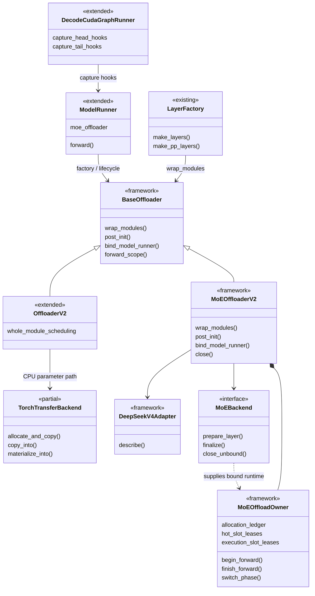
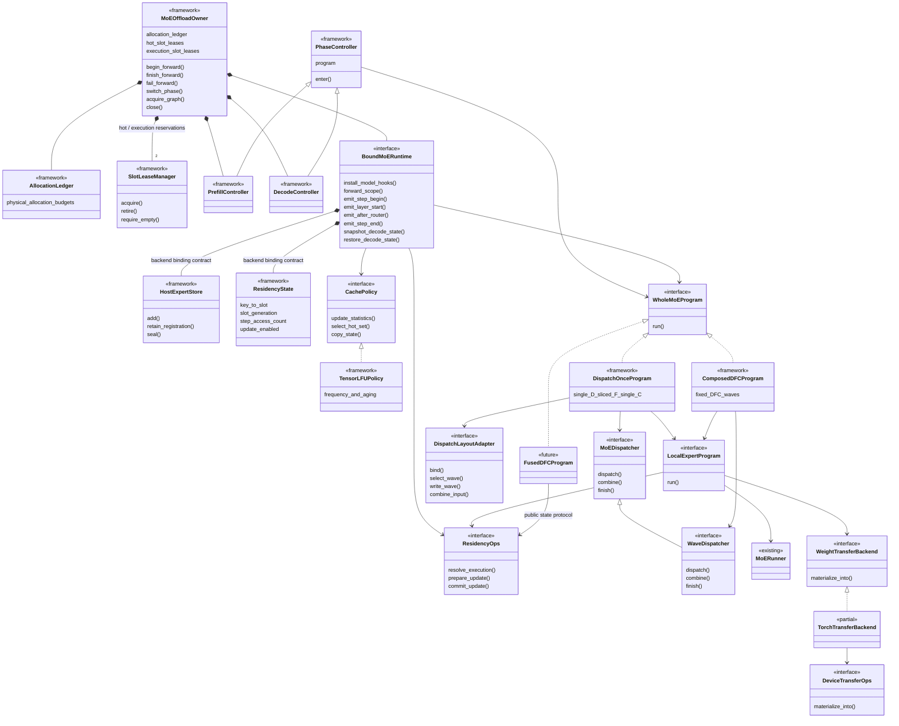
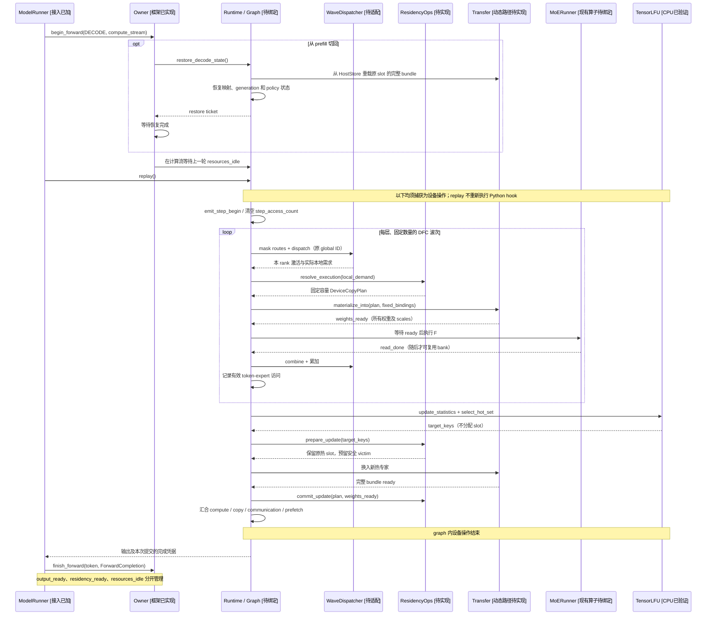
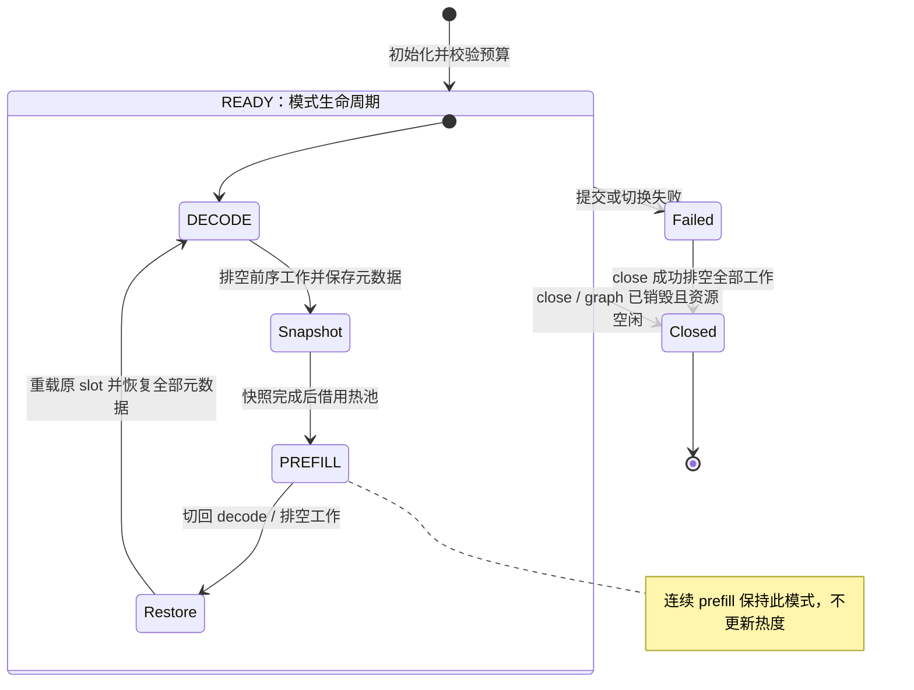

# MoE 权重 Offload 框架

> **2026-10-22 缓存更新**：原生 Ascend 启动入口使用按层预热、周期层内 LFU
> 及设备端 assignment 命中统计；离线统计可选，在线保持初始化确定的每层配额。配置、物理后端边界
> 和当前验证方法见 [周期缓存接入](../npu/doc/PERIODIC_CACHE_1022.zh-CN.md)。

> **2026-10-21 实现更新**：已接入 Tensor cache、有界 prefill、原生 ACL batch、
> ACL/MemFabric 共用 host 存储、V4 FP4 loader、具体运行时和 DeepEP/Ascend FFN bank。
> 启动入口和支持范围见 [运行时](../npu/doc/README.zh-CN.md)；实现见
> [ACL](../npu/native/doc/README.zh-CN.md)、[存储](../npu/doc/V4_STORAGE.md)、
> [EP/FFN](../npu/doc/EXPERTS_IMPLEMENTATION.zh-CN.md)，测试见
> [本地验证](LOCAL_VALIDATION_1021.zh-CN.md)。
> A5/CANN 原生编译、数值对齐、完整图和性能仍待目标机验收。

[English](README.md) | 中文

[三人开发分工与任务计划](DEVELOPMENT_PLAN.zh-CN.md)

公共 cache、policy、资源协议和执行编排位于上级 `moe/` 目录。仅用于 Ascend 的实现归入
[npu/](../npu/doc/README.zh-CN.md)：backend、runtime、transfer、原生 V4 存储、ACL C++
源码、启动配置及对应说明。`../npu/__init__.py` 不加载原生库或初始化设备。

本模块面向 **DeepSeek V4 Flash 原生 FP4 权重、A5 多卡 TP + EP**，为 CUDA / NPU 提供共同的专家身份、缓存策略、资源所有权和执行程序接口。

当前包含公共框架及实验性 Ascend 具体后端，CUDA 仍是扩展点。完整 decode graph 是必须满足的验收条件，不能用 eager fallback 替代；缓存及原生装配的 CPU 契约测试已恢复，硬件验收仍需在目标机完成。

本文的架构图沿用框架提交 `65e5c53ebb` 及后续 DispatchOnce 扩展；接口标记描述可移植契约，具体 Ascend 实现以顶部链接的说明为准。下文保留之前讨论的三张 UML 的主题及 prefill/decode 切换状态图。

## 2026 年 10 月 21 日 H2D 抽象落地

[H2D 设计与调用契约](moe-h2d-design.zh-CN.md) 对应的公共抽象和组合逻辑已落地：

| 入口 | 当前实现 |
| --- | --- |
| [transfer.py](../../transfer.py) | `HostCopyRegion` / `HostCopyPlan`、`HostTransferOps`、`ComposedTransferBackend`，与已有 `DeviceTransferOps` 组合；不绑定默认硬件后端 |
| [execution.py](../execution.py) | `ExecutionRequest`、`ExecutionReservation`、`UpdatePlan`、`WeightLease`、`ExpertWeightAccess`、`CacheUpdateCoordinator` |
| [interfaces.py](../interfaces.py) | `ExecutionContext` 的保活/完成契约；临时驻留发布与 reader 结束；Dispatch completion；runtime 层首/尾部默认委托 |
| [prefill.py](../prefill.py) | `PrefillWeightPipeline` 契约及 `BoundedPrefillWeightPipeline` 有界 worker：start / validate_session / seal / acquire / finish / abort |
| [programs.py](../programs.py) | `PrefillDispatchOnceProgram`、`PrefillLocalExpertProgram`、`DecodeLocalExpertProgram`；复用公共 D/F/C，不复制整套 forward |

实际接入时，runtime 绑定 `ComposedTransferBackend(host_ops=..., device_ops=...)` 和 `ExpertWeightAccess`，并设置 `cache_updates = CacheUpdateCoordinator(...)`。prefill 另行注入具体 pipeline；local program 的 `run_experts` 返回 `LocalExecution(output, read_done)`。所有对象与物理分配仍由 bound runtime / owner 管理。

ACL batch 扩展、MemFabric device lowering、TensorResidencyOps、prefill worker 和模型 hooks 已实现；完整 A5 graph 仍待硬件验收。Decode 当前 wave 的复制还需等待计算流 frontier，保证相邻 wave 即使用不同 bank 也不提前搬运。

## 1. 已确认的设计边界

| 维度 | 首版约定 |
| --- | --- |
| 权重来源 | 所有可卸载 routed expert 的完整原生权重 bundle 保存在 pinned DRAM，作为不可变权威副本；device 热池和执行区按需载入。bundle 包含权重、scales 及格式要求的其他分量。 |
| 常驻范围 | shared experts、前三层 routed experts 在 prefill 和 decode 都常驻；适配器同时排除其他标记为 hash 的层。 |
| 并行方式 | 多卡启用 EP，每个 rank 只持有和执行自己负责的专家；支持目标为 TP + EP，首版 `moe_tp_size=1`，EP 专家均匀、连续分配。 |
| 热池容量 | 按本 rank 的可卸载专家总数计算，允许跨层竞争，不为每层固定保留配额。 |
| 临时执行 | miss 权重进入显式执行区；临时使用不等于热缓存准入。双缓冲、hit 的执行副本也计入预算。 |
| Prefill | 按本层所有本地专家组织全量流式预取；从 layer-start 开始预取，router 后进入分波计算。全量表示覆盖全部专家，不要求同时驻留整个层。 |
| 模式切换 | 第一次进入 prefill 时保存精确热布局及策略状态，借用热池；连续 prefill 不反复保存或恢复。切回 decode 时恢复原 slot、专家、有效位、generation 和 LFU 状态。prefill 不更新热度。 |
| 执行单元 | 一次 step 是一个 batch 的一次完整模型 forward；支持多轮完整 D/F/C，或一次 D、分片 F、一次 C。 |
| Decode | 本次 forward 内保持热集合不变，尾部才根据策略更新热集合；完整动态路径必须进入 graph。 |
| 并发 | 不允许两个 forward 同时使用资源；连续异步提交通过设备完成依赖串行化。 |
| 首版排除 | EPLB、弹性或重映射 EP、在线权重更新、投机解码、MoE TP、forward 重叠及不兼容的 shared-expert 融合。 |

因此，淘汰一个热专家通常只需失效并复用 device slot，无需将权重 D2H 写回；权重仍可从 pinned DRAM 重载。这里不采用 HBM/DRAM 独占 swap，也不采用 INT8 转换或分段 eager graph 的旧方案。

## 2. 代码入口与接入顺序

开发入口为 `ModelRunner(..., moe_offloader=MoEOffloaderV2(config, backend))`。Ascend 另提供 `--moe-offload-config` JSON 启动入口，由 `NpuMoEBackend` 在模型构造前接管 FP4 host 分配；未启用时保留原 offloader 选择。

```python
from sglang.srt.offloading.moe import MoEOffloadConfig, MoEOffloaderV2, TensorLFUPolicy

# backend 必须由硬件适配提供；以下仅展示依赖注入方式。
config = MoEOffloadConfig(
    cache_ratio=cache_ratio,
    execution_slots=total_execution_slots,
    ep_size=ep_size,
    ep_rank=ep_rank,
    tp_size=tp_size,
    moe_tp_size=1,
    metadata_limit_bytes=metadata_budget,
    workspace_limit_bytes=workspace_budget,
)
offloader = MoEOffloaderV2(config, backend, policy=TensorLFUPolicy())
# 在原有 ModelRunner 构造参数中增加 moe_offloader=offloader。
```

| 顺序 | 入口 | 当前行为与边界 |
| --- | --- | --- |
| 1 | [create_offloader](../../../utils/offloader.py)、[ModelRunner](../../../model_executor/model_runner.py) | 接受显式 MoE 实例，拒绝与旧模块 offloader 共同拥有权重；不传入时保留原有 V1/V2/Noop 选择。 |
| 2 | [make_layers / make_pp_layers](../../../utils/common.py) → `wrap_modules()` | 沿用现有层构造接入点。`DeepSeekV4Adapter.describe()` 描述层及 EP 归属，对可卸载层调用 `backend.prepare_layer()`。 |
| 3 | `post_init()` → `backend.finalize()` | 在平台 post-load 后绑定原生格式、固定地址资源和执行程序，创建 owner，检查能力声明及预算。Ascend 由 `V4LayerStorage` 实现有界加载。 |
| 4 | `bind_model_runner()` | 设置在线更新限制标记，委托 `NpuBoundMoERuntime` 安装 layer-start、router、step 和 graph hooks。 |
| 5 | `ModelRunner.forward()` → `forward_scope()` | 包围 eager 执行或 graph replay。runtime 负责调用 owner 的 begin/finish/fail，以及为每次提交生成新的完成凭据。 |
| 6 | [DecodeCudaGraphRunner](../../../model_executor/runner/decode_cuda_graph_runner.py) | `capture_head_hooks` 与 `capture_tail_hooks` 对齐；NPU 由具体 runtime 绑定。 |
| 7 | `close()` | 显式销毁 graph、释放 graph lease，再排空工作、释放资源。实际模型销毁路径由 runtime 接入。 |

主要源文件：

| 文件 | 职责 |
| --- | --- |
| [base.py](../../base.py) | `BaseOffloader` 公共接入契约；旧 `utils.offloader` 导入路径继续暴露该类。 |
| [transfer.py](../../transfer.py) | `Completion`、`TransferTicket`、`DeviceCopyPlan`、传输接口与普通 PyTorch 实现。 |
| [config.py](../config.py) | `MoEOffloadConfig`、`ExpertLayerSpec`、`ExpertCatalog`、`ExpertWave`、`fixed_waves()`。 |
| [offloader.py](../offloader.py) | `MoEOffloaderV2` 门面和 `DeepSeekV4Adapter`。 |
| [owner.py](../owner.py) | 唯一 owner、两个模式控制器、forward token、graph lease、切换与关闭流程。 |
| [resources.py](../resources.py)、[storage.py](../storage.py) | 物理内存记账、host 侧 slot 预约、pinned 权重及注册句柄持有。 |
| [state.py](../state.py)、[policy.py](../policy.py) | 公共缓存 tensor 状态、独立 LFU 状态及策略实现。 |
| [interfaces.py](../interfaces.py)、[programs.py](../programs.py) | 后端扩展点、固定多轮 DFC 和一次 D / 分片 F / 一次 C 编排。 |

## 3. UML：从当前框架生长

图例：`existing` 为原有组件，`extended` 为已修改的原有接入点，`framework` 为已实现的框架逻辑，`partial` 为部分实现，`interface` 为已有接口但待实现具体后端，`future` 为预留扩展方向。**这些标记不代表硬件验收已通过。** 实心菱形表示所有权，普通箭头表示使用关系。

### 图一：现有 SGLang 与新增 offloader 的接入关系



`MoEOffloaderV2` 与 `OffloaderV2` 共同继承 `BaseOffloader`。旧 V2 保留整模块轮转、参数 whitelist 和 `functional_call`；新路径组合 owner 和 program，管理固定专家 slot。当前已共享 CPU 参数传输入口，尚未把旧 V2 的全部存储、stream 和调度实现改造成统一后端。

### 图二：唯一 owner、模式控制器和可替换程序



几个组件的职责边界可以这样理解：

- **HostExpertStore**：持有本 rank 可卸载专家完整权重 bundle 的 pinned DRAM 权威副本及相关主机内存注册句柄。
- **CachePolicy**：决定谁值得留在热缓存。
- **ResidencyState**：保存“谁在哪个 slot”的设备 tensor 数据。
- **ResidencyOps**：查询和修改这些数据，生成安全的加载、替换计划。
- **WeightTransferBackend（传输后端）**：执行实际权重搬运。
- **AllocationLedger**：记录唯一物理内存分配、校验字节预算，并持有分配对象的保活引用。
- **SlotLeaseManager**：在图外预约 bank/区域的使用权。

图中 runtime 的资源持有关系、local program 对 runner 的绑定是后端必须兑现的契约。`AllocationLedger` 通过 `owner.allocation_ledger` 记录唯一物理分配并校验字节预算；`SlotLeaseManager` 通过 `owner.hot_slot_leases` 和 `owner.execution_slot_leases` 管理 host 侧 slot 预约、租约 generation 与延迟回收。归还租约只释放使用权，物理权重 tensor 仍由 runtime 持有。replay 内的动态替换由设备侧 `ResidencyOps` 实现；物理池由 runtime 创建并列入 `resources`。

之前 UML 中的概念与当前代码对应如下，避免把设计名当作已存在的类：

| 原设计名称 | 当前落点与状态 |
| --- | --- |
| `OffloadStorage` | 新 MoE 路径为 `HostExpertStore`；旧 V2 仍使用原参数适配器，没有名为 `OffloadStorage` 的统一实现。 |
| `ExpertArena` / `HotArena` / `ExecutionArena` | owner 的两个 `SlotLeaseManager` 预约管理器，加上 runtime 提供的实际物理池。 |
| `ResidencyManager` | 拆为已实现的 `ResidencyState` 数据协议和待实现的 `ResidencyOps` 设备操作。 |
| `LFUPolicy` | `TensorLFUPolicy`；算法状态为独立 `LFUState`。 |
| `begin_step()` / `finish_step()` | host 事务为 `begin_forward()` / `finish_forward()`；图内每步操作为 runtime 的 `emit_step_begin()` / `emit_step_end()`。 |
| `snapshot()` / `restore()` | 策略状态通过 `CachePolicy.copy_state()` 复制；完整模式恢复通过 runtime 的 snapshot/restore 接口完成。 |
| `WaveActivationAdapter` / `WeightMaterializer` | 一次 D/C 的分片布局由新接口 `DispatchLayoutAdapter` 承接；权重物化仍由 `LocalExpertProgram` 及传输接口承接，无独立同名类。 |
| `FusedDFCProgram` | 扩展方向，代码中尚无该类；未来实现 `WholeMoEProgram` 即可接入。 |

### 图三：decode 执行顺序与完整 graph 边界

下图是目标执行协议。owner 的 host 控制已实现；图中 graph 标注范围的完整串联、设备 residency、动态 H2D 及 EP 适配仍待具体 runtime 实现。LFU 和固定 DFC 编排已有实现，不能据此认定整张图已可在 A5 上运行。



router 后可以发出路由记账及规划操作，但 EP dispatch 后才得到该 owner rank 的完整本地需求。通信继续使用原 global expert ID；只有本地 F 将专家转换为执行 bank lane。上图采用多轮 DFC：所有 rank 执行相同数量、相同顺序的 DFC，空波也必须有经过验证的处理。

`ComposedDFCProgram` 顺序执行 `D0/F0/C0 → D1/F1/C1`，不跨波覆盖 dispatcher handle；各波结果累加后只调用一次公共 `finish()`。shared experts 在 routed program 外执行。下一波权重可以预取，但预取不能破坏当前 bank 的读者保护。

### 一次 D、分片 F、一次 C：DispatchOnceProgram

新增 `DispatchOnceProgram` 继承同一 `WholeMoEProgram`，流程为 `D → F0 → F1 → … → C → finish`。后端可将它绑定为 `runtime.prefill_program` 或 `runtime.decode_program`，owner、模式控制器、缓存策略和传输能力继续复用；不自动改变当前模型路径。

```python
program = DispatchOnceProgram(
    fixed_waves(spec.local_experts, bank_slots, bank_count),
    dispatcher,
    local_program,
    layout_adapter,
    local_experts=spec.local_experts,
)
```

- `MoEDispatcher` 提取公共 D/C/finish 契约；原 `WaveDispatcher` 继承它并保留 mask/accumulate，已有多轮 DFC 实现仍可使用。
- 构造时检查 waves 连续、无重叠、无遗漏，覆盖 `[0, local_experts)`；bank 容量与格式仍由 runtime 校验。D 接收原路由，不按 wave 屏蔽或重归一化权重。
- `DispatchLayoutAdapter.bind()` 绑定完整接收布局；`select_wave()` 提供每片 activation、scales、counts；`write_wave()` 将 F 结果放回原接收位置；`combine_input()` 提供原通信元数据与完整输出。这里不是 token 累加，也不额外应用 top-k 权重。
- `LocalExpertProgram` 继续负责权重准备、等待、F 与读者保护。当前类顺序执行各片 F，**交替 bank 编号不等于已经实现 H2D 双缓冲**；预取与跨片流水仍需具体后端实现。
- 完整接收/输出和必要 packing workspace 必须由 runtime 持有、计入预算，并保留至设备消费者完成；异常后的资源排空继续遵守 owner 协议。不得因 Python 方法返回就复用通信或分片缓冲。
- graph 中使用静态 wave 数量和设备侧动态 counts/masks；禁止 `.item()` 驱动动态切片。紧凑布局、padded 布局、空组和尾片均需后端适配，当前没有 A5/CUDA 的具体布局实现。

CPU 测试对照未分片 FFN，验证 top-k 加权、原接收位置回填、scales、空 rank/空波、尾片、复用临时 F 输出、改变路由和异常传播。它们验证公共编排，不代表真实 DeepEP 或完整 decode graph 已通过。

### 补充图：prefill 借池与恢复生命周期



这是生命周期概念图：代码中的 `OwnerState` 只有 `READY/FAILED/CLOSED`，运行状态由 `phase`、forward token、pending completion 和 snapshot 标志共同表达。finish 结束的是 host 提交事务，不保证设备已空闲；下一轮仍需等待 `resources_idle`。控制流程已实现，快照内容、真实重载和完成事件由 runtime 实现。排空失败时保留资源并报错，不能假装关闭成功。

## 4. 内存、专家身份与资源保护

```text
N = sum(每个可卸载层的本 rank 专家数)
K = floor(cache_ratio * N)
S = execution_slots                         # 所有临时 bank 的总容量
B = 一个原生完整专家 bundle 的物理字节数       # 包含 scales、padding

HOST_WEIGHTS      = N * B
HOT_WEIGHTS       = K * B
EXECUTION_WEIGHTS = S * B
```

首版预算按同构专家 bundle 计算。若各层格式或专家字节数不同，必须扩展格式分组和预算协议，不能用平均字节数掩盖差异。常驻权重由原模型持有，不计入上述可卸载池。

`AllocationLedger` 对 host/hot/execution 三类权重要求实际申报量与 slot 预算一致，metadata/workspace 则不能超过显式上限，默认上限为零。LFU 排序临时量、快照、传输计划、graph 内存峰值及任何 staging 都要申报。视图不重复计费；不得省略真实分配。它校验的是后端的资源申报，实机仍需核对 allocator 峰值。

三种身份必须分开：global expert ID 用于路由和 EP，`ExpertCatalog.key(layer_id, local_id)` 用于本 rank 的跨层缓存，bank lane 用于本轮专家计算。cache slot 数不能替换模型的逻辑专家数或通信专家数。

连续 `[W, ...]` 权重 bank 是兼容现有 runner 的方案：hit 从热池 D2D 到 bank，miss 从 host H2D 到 bank。支持 slot 索引的 runner 可直接使用热 slot。双缓冲需要计入两个 bank；prefill 也可将热池的视图用作 bank，但不能额外申请未申报的权重副本。

| 保护对象 | 规则 |
| --- | --- |
| `HostExpertStore` | 接收已有 pinned tensor，不隐式复制；`seal()` 固定绑定，内容按契约保持不可变；后端注册句柄与 store 一同持有。pinned 不自动意味着设备可直接寻址。 |
| `TransferTicket.keepalive` | 保持 source、destination、plan、registration 存活直到完成；跨流工作必须纳入完成依赖。 |
| `weights_ready` | 整个专家 bundle 全部分量可读后，才能计算或发布有效映射。 |
| `read_done` | 覆写 bank 或 slot 前必须等待所有旧读者结束。 |
| `SlotLease` / generation | host 预约进入 retiring 后，在 idle 完成前不能重用；图内动态条目由 `ResidencyOps` 实现对应保护。 |
| `ForwardCompletion` | 输出可用、热布局可用、全部资源空闲是三个不同边界；最后一个覆盖计算、搬运、通信及预取。 |
| `GraphLease` | 每个 graph bucket 持有 owner；先销毁 graph 再释放 lease。存在 lease 时 owner 拒绝释放存储。 |

## 5. 可替换接口及不同 H2D 实现

策略只选择热专家集合，residency 决定位置和发布时机，传输只按计划准备权重。融合到哪一层，就替换哪一层 program，继续复用同一份公共状态和资源预算。

| 实现方式 | 接口落点 | 当前进度 |
| --- | --- | --- |
| 普通 PyTorch 搬运，host 已知源和目标 | `TorchTransferBackend.copy_into()`；调用方提供固定 destination、stream、event。旧 V2 整参数分配使用 `allocate_and_copy()`。 | 已实现普通拷贝包装；适合静态计划。各硬件行为仍需回归。 |
| graph 中动态源选择 | `TorchTransferBackend(device_ops=...)` → `DeviceTransferOps.materialize_into()`；算子读取 device plan 并写固定 slot。 | 接口已定义；缺少 device ops 时明确报错。A5 / CUDA lowering 均待实现。 |
| 注册 host 内存后由 device 发起搬运 | 实现 `DeviceTransferOps` 或替换 `WeightTransferBackend`；注册句柄由 store / ticket 持有。 | 预留接口；注册方式、寻址、可见性和同步须各后端验证。 |
| 搬运与本地 F 融合 | 替换 `LocalExpertProgram.run()`，保留外层 D/C 编排。 | 接口已定义，无具体融合实现。 |
| offload + DFC + 预取整体融合 | 实现 `WholeMoEProgram.run()`，替换 `ComposedDFCProgram`。 | 预留扩展；仍需遵守公共 residency、generation、完成依赖及预算。 |

`DeviceCopyPlan` 固定容量，字段包括 `source_kind`、`source_index`、`destination_slot`、`valid`、`expected_generation`、`count`。`HOST/HOT_SLOT/NONE` 区分 H2D、hit D2D 与无效项；具体绑定负责解释目的 slot/bank。

`tensor.to()` 本身不会解决 graph replay 的动态源选择。捕图时用 Python 根据专家 ID 展开固定 `.to()` 或 `copy_()`，重放不能自动访问新的专家。decode 的计划生成、选源、热度更新、换入及提交必须是图内设备操作，不可用 `.item()`、`.tolist()` 或 CPU 决策补齐。

## 6. LFU 与 graph 契约

`TensorLFUPolicy` 是第一个完整算法实现，不是空桩。它统计一次完整 forward 中有效的本地 token-expert 执行次数，包含未缓存专家；频次饱和避免溢出，可选按 step 衰减。同频次优先保留 resident，再按稳定 key 打破平局；未访问专家以 `-1` 留空，不强行填满冷缓存。

算法状态由 policy 自己管理，不塞入公共 `ResidencyState`。`select_hot_set()` 输出最多 K 个 key，不分配 slot、不传输权重。runtime 在尾部生成差异计划，保留幸存专家的原 slot，等待 victim 读者结束，加载新成员后再提交。临时 bank 可能已复用，因此新热专家可能需要二次 H2D；不能为避免这次传输私藏全部 miss 权重。

完整 decode graph 还要求：

1. capture 前固定 host/device 存储、metadata、plan 和必要 workspace 的绑定；实际需求通过 device mask/count 表达。
2. 每层静态 wave 数与各 rank collective 顺序一致，验证全空波、尾波、padding 和需求不对称。
3. runtime 统一安装 eager/capture 的 step begin/end，避免同一 forward 重复计数；Python hook 只在 capture 时发出图内操作。
4. warmup/capture 使用固定地址的 device `update_enabled=false`，同时禁止热度更新和 residency commit；正式 replay 再开启。单独屏蔽 LFU 不足以保护热布局。
5. 每次 replay 使用本次提交的完成事件，不复用 capture 时的 host ticket 作为完成证据。
6. `RuntimeCapabilities.require_decode()` 要求完整 graph、动态专家选择和公共 residency 三项声明；声明检查已实现，实际能力仍必须通过硬件测试证明。

## 7. 当前实现状态

| 组件 / 能力 | 状态 | 尚缺的部分 |
| --- | --- | --- |
| `BaseOffloader` 与 ModelRunner 接入 | 框架已实现 | 具体 runtime 的完整模型安装与销毁接入；旧 V2 硬件回归。 |
| `MoEOffloaderV2`、V4 scope、EP catalog | 框架已实现 | 原生 checkpoint 加载及硬件模型路径验证。 |
| owner、两个控制器、预算、forward / graph lease | 框架已实现，CPU 契约已验证 | 实际设备分配、跨流事件、graph bucket 的集成。 |
| `HostExpertStore`、`ResidencyState` | 数据结构和存储契约已实现 | loader、原生 FP4 format、设备池绑定和注册实现。 |
| `TensorLFUPolicy` | 算法已实现，CPU 已验证 | NPU / CUDA 算子、排序 workspace、反复 graph replay 验证。 |
| `ComposedDFCProgram` / `fixed_waves()` | 编排已实现，CPU 已验证 | `WaveDispatcher`、`LocalExpertProgram` 与真实 EP / runner 适配。 |
| `DispatchOnceProgram` | 一次 D、分片 F、一次 C 编排已实现，CPU 数值对照已验证 | `MoEDispatcher`、`DispatchLayoutAdapter` 与真实 EP 布局/设备动态分片适配；实际 H2D 流水。 |
| 普通 PyTorch 传输 | 静态拷贝包装已实现 | accelerator 回归及图内动态 lowering。 |
| `ExpertFormat` / `MoEBackend` / `BoundMoERuntime` | 接口已定义 | 有界权重加载、布局转换、资源创建、hooks、prefetch、恢复和清理。 |
| `ResidencyOps` / `DeviceTransferOps` | 接口已定义 | device miss 规划、victim 保护、动态搬运、generation 检查和安全发布。 |
| Prefill 全量预取与双缓冲 | 接口及模式控制已定义 | 实际预取流水和 bank 读写事件。 |
| 精确 prefill → decode 恢复 | owner 控制已实现，fake runtime 验证 | 真实快照、原 slot 权重重载及跨 graph bucket 恢复。 |
| A5 多卡完整 decode graph | 未完成 | M0–M5 硬件交付与性能验证。 |

## 8. 交付里程碑与验收

框架提交先落地了跨里程碑的公共结构，**不代表 M0 或 M1 已通过**。后续硬件开发仍按 M0 → M5 顺序验收。

| 节点 | 必须交付与验收 | 当前进度 |
| --- | --- | --- |
| **M0：A5 最小技术闭环** | A5 双卡 EP、原生 FP4 bundle、固定目标 buffer、动态搬运和计算进入同一 graph；改变路由反复 replay，覆盖 hit/miss、非对称需求、空组，对齐常驻基线。 | 待实机验证。 |
| **M1：共享底座与资源所有权** | 具体存储/传输绑定、有界原生加载、精确物理预算与故障测试；加载阶段也不能先占用完整 routed HBM；旧 V2 回归通过。 | 公共 owner/store/ledger/lease 已实现；加载和硬件绑定待完成。 |
| **M2：单层执行程序** | prefill 全专家分片预取和双缓冲；decode hit/miss 完整 graph；容量不足、多 DFC、尾波和空波正确，公共尾处理仅一次。 | 固定 waves、多轮 DFC 和 DispatchOnce 编排已实现；真实执行和流水待完成。 |
| **M3：可替换策略与跨层 LFU** | device residency、跨层热集合选择及尾部换入事务；CPU 参考差分验证；replay 中热集合持续变化，临时 miss 不直接准入。 | policy 接口及 Tensor LFU 已实现；设备事务和 replay 验证待完成。 |
| **M4：模式切换与恢复** | prefill 借池、连续 prefill、原 slot/LFU 精确恢复；所有读写受保护，warmup/capture 不污染状态，各 graph bucket 恢复一致。 | host 状态机已实现；实际快照/重载及设备验证待完成。 |
| **M5：整模型交付** | V4 Flash 原生权重、A5 多卡 TP + EP、完整 decode graph、模式交替、多 batch bucket 与适用的 IDLE；CUDA 契约验证；内存、流量、命中率和性能报告。 | 待前序节点通过。 |

主要未验证风险是原生 FP4 布局与 scales 的固定 bank 写入、图内动态选源、EP 空波/非对称需求、多流同步、排序与 graph allocator 的真实峰值。静态 waves 可能增加通信次数，连续 bank 的 hit D2D、尾部热准入二次 H2D、prefill 恢复也有显式流量成本；接口可替换，但性能收益必须实测。

## 9. 验证方式

CPU 单测、模拟搬运实现和 runner 已移除。使用匹配的 CANN / torch_npu / MemFabric
及 DeepEP，在目标 NPU 上验证原生 FP4 权重、搬运时序、空/尾组、真实 EP、完整
graph replay、prefill/decode 精确恢复及内存和性能。下方更新记录保留历史提交信息。

## 10. 更新记录

| 日期 | 版本 / 变更 | 更新内容 | 验证与剩余边界 |
| --- | --- | --- | --- |
| 2026-10-20 | DispatchOnce 编排扩展 | 新增 `DispatchOnceProgram`、公共 `MoEDispatcher` 与 `DispatchLayoutAdapter`；复用本地 F/权重传输契约，新增完整分片校验，更新 UML 与中英文文档。 | 新增 6 项 CPU 测试，合计 37 项通过；真实 DeepEP 布局、H2D 双缓冲和设备 graph 仍待适配。 |
| 2026-10-20 | 中文文档补充 | 新增本 README；收录并对齐此前三张 UML，补充模式生命周期图；标注实现状态、旧设计名映射、代码入口、H2D 扩展方式与 M0–M5 进度；英文 README 增加中文入口。 | 四张 Mermaid 图渲染及相对链接校验通过；不新增硬件能力，状态以 `65e5c53ebb` 为基线。 |
| 2026-10-20 | `65e5c53ebb` — 框架初版 | 提取 `BaseOffloader`，共享 PyTorch 传输入口；加入 MoE 门面、唯一 owner、两模式控制器、预算与 lease、pinned store、公共 tensor 状态、LFU、DFC 编排及 backend 接口；接入 ModelRunner 和 capture head。 | 31 项 CPU 契约测试及静态检查通过；无具体 accelerator runtime，M0 实机门槛尚未通过。 |

后续每次交付更新此表、实现状态表与里程碑进度。只有代码及相应测试完成后才标为已完成；接口定义、CPU 验证与硬件验收分别记录。
