# Prefill 侧专家卸载基本框架

本文先划分类的职责边界、对象归属和调用关系，讨论 `mode=prefill_only`、`prefill_resident_ratio > 0` 且取整后每层常驻数 `R > 0` 的每层部分专家常驻路径。代码依据：`simplify` 工作树，基准提交 `5b9f6624c0`；核对日期：2026-11-16。

文中的范围均为当前 worker / rank；启用 PP 时，模型执行和专家目录只覆盖本 rank 所属 stage。当前部分常驻路径要求 ModelSlim W8A8。主调用链以 AscendOps dispatcher 为例，DeepEP 的接入差异单独说明。

## 1. 核心类的职责边界

| 类 | 管理范围与主要职责 | 职责边界 |
|---|---|---|
| `TpModelWorker` | worker 级入口；创建 `ModelRunner`，把调度批次转换为 `ForwardBatch`，调用模型执行并组织返回结果。 | 调度批次进入模型的边界；专家存储和预取细节由下层完成。 |
| `ModelRunner` | 持有模型和 `moe_offloader`；组织模型加载、设备执行及运行资源；用 `forward_scope` 包住一次 `_forward_raw()`。 | 管理一次模型前向的外层生命周期；每层的权重就绪和缓冲区复用由 offloader 子组件处理。 |
| `FusedMoE` | 模型树中的专家模块，接收 hidden states 和上游的 top-k 结果；组织 `dispatch → run_moe_core → combine`，持有量化方法和 dispatcher。 | 这里的 `layer` 指专家模块；整个 DecoderLayer 还包含 attention 等计算。专家路由结果由上游提供。 |
| `BaseOffloader` | 通用 offloader 基类；提供 `wrap_modules()`、`post_init()` 和 `forbid_copy_engine_usage` 的默认行为。 | 基类没有定义 `prepare_layer()`、`prepare_weights()` 或 `forward_scope()`；这些是具体 MoE offloader 扩展出来的接口。 |
| `AscendOpsOffloader` | 当前 rank 的 MoE offload 管理对象，即代码中的 `owner`；持有专家目录、各层 Host 存储、格式对象、NPU 权重池、复制流、执行策略和当前调用上下文。 | 负责资源归属和对外接入；把加载细节、Prefill 供权、流水线时序分别交给 storage、prefill 和 pipeline。 |
| `ExpertLayerStorage` | 每个受管理专家层一个实例；分配 Host 区域、向 `FusedMoE` 注册参数及 `weight_loader` 回调；接收本 rank 的全部专家分片；校验、逐专家转换并封存 Host 主副本。 | 管理单层权重的加载状态及 Host 数据；运行时搬运计划和 NPU 缓冲区轮转由其他组件管理。 |
| `PrefillOnlyExecution` | `prefill_only` 执行策略；校验配置和拓扑、计算常驻数及槽位数；在 `post_init(owner)` 中建立 NPU 执行资源；实现整轮 `forward_scope(owner, batch)`。 | 它由 offloader 持有，通过方法参数接收 `owner`；自身不是 `BaseOffloader` 的子类，也不实现专家矩阵计算。 |
| `AscendPrefillWeights` | 当前 rank 跨层共享的 Prefill 权重供给对象；建立常驻/冷专家视图、填充常驻权重、建立 W13/W2 搬运计划、提供 `quant_info` 和分组信息、通知层使用结束。 | 借用 `owner` 的 Host 主副本和 NPU 大权重池，自己建立视图、元数据、传输对象及 pipeline；实际 GMM 由 runner 执行。 |
| `LayerPrefetchPipeline` | 一个实例跟踪本轮所有受管理层；维护层顺序、当前层序号、双缓冲选择和 W13/W2 完成凭据；安排初始预取与后续复用。 | 通过注入的 `load` 回调提交搬运；不解释权重格式，也不执行路由、矩阵计算或通信算子。 |

源码入口：[TpModelWorker][worker]、[ModelRunner][modelrunner]、[FusedMoE][fused]、[BaseOffloader][baseoffloader]、[AscendOpsOffloader][offloader]、[ExpertLayerStorage][storage]、[PrefillOnlyExecution][strategy]、[AscendPrefillWeights][prefill]、[LayerPrefetchPipeline][pipeline]。

## 2. UML 类图：对象归属与引用

图例：`<|--` 表示继承，`*--` 表示创建并持有的主要组成对象，`-->` 表示保存对象引用，`..>` 表示调用依赖。组合线描述本特性的逻辑归属，不表示 Python 中没有其他引用，也不承诺析构顺序。

`L` 是本 rank / stage 中受管理的 routed MoE 层数。图中省略与本特性无关的基类；`ModelModule` 是模型模块树的概念节点，代码中没有这个同名类。

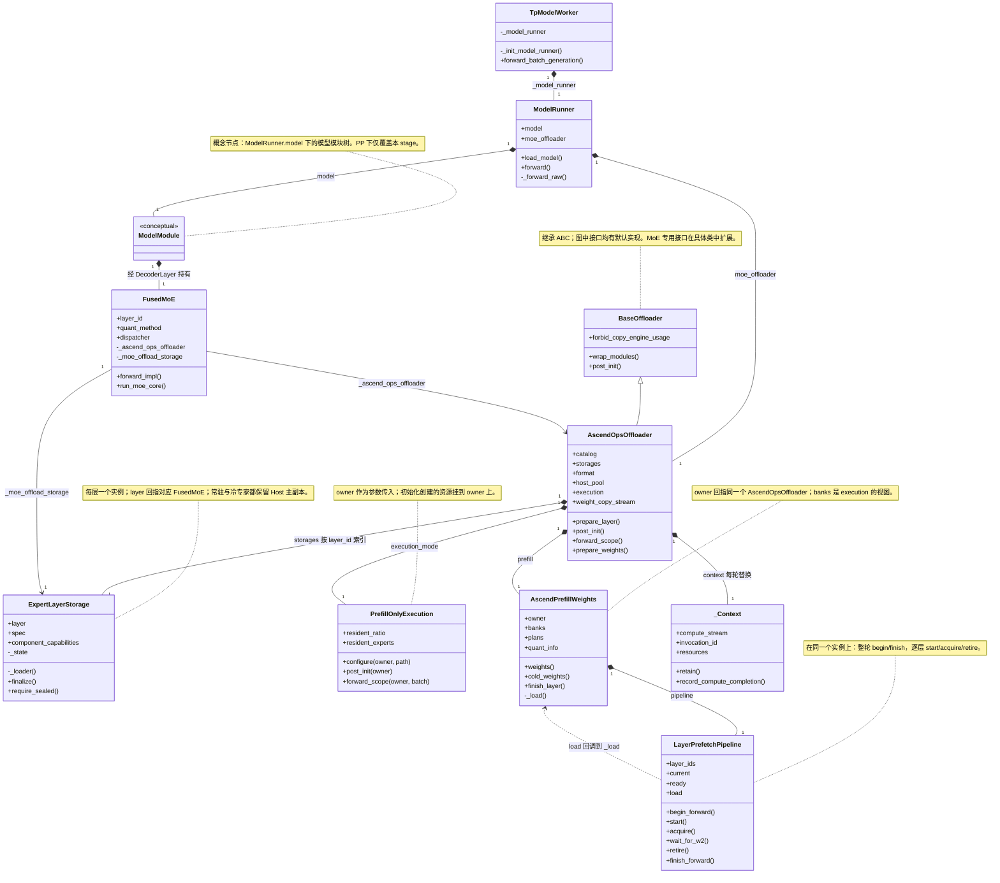

对象关系中的几个关键约定：

- `owner` 就是 `ModelRunner.moe_offloader` 指向的 `AscendOpsOffloader`。各层的 `_ascend_ops_offloader` 和 `AscendPrefillWeights.owner` 都引用这个对象；并非每层创建一个 offloader。
- `set_offloader()` / `get_offloader()` 提供进程内的对象访问入口。创建专家参数时从该入口取得 owner；接管层后，运行时可以直接沿着层保存的引用取得 owner。[全局访问入口][baseoffloader]
- `prepare_layer()` 创建 storage，并登记 `owner.storages[layer_id]` 和 `layer._ascend_ops_offloader`；storage 自己登记 `layer._moe_offload_storage`。[层接管][preparelayer]、[参数注册][storageparams]
- `PrefillOnlyExecution` 通过 `owner` 操作长期资源；`_Context` 在初始化时创建一次，每轮 forward 再替换，保存本轮计算流、唯一调用标识及异步操作所需引用。实际权重复制流使用 `owner.weight_copy_stream`。[运行资源建立][postinit]、[调用上下文][context]
- `AscendPrefillWeights` 持有 pipeline；pipeline 的 `load` 保存的是绑定方法 `AscendPrefillWeights._load`。调度器决定何时搬哪层，回调决定实际提交哪些 W13/W2 复制计划。[回调注入][prefill]

## 3. UML 类图：模型计算与 offloader 的接入点

`FusedMoE` 与 offloader 之间还经过量化方法、通用 MoE runner 和 NPU runner core。下图保留这些桥接类；虚线上的文字表示调用关系。

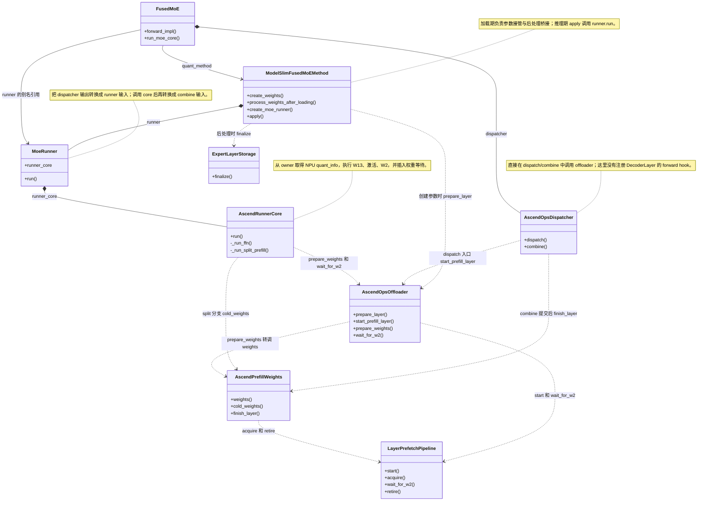

源码定位：[ModelSlim 接入][modelslim]、[FusedMoE 的 runner/dispatcher 创建][fusedcreate]、[MoeRunner 的前后转换及 core 调用][moerunner]、[AscendRunnerCore][runnercore]、[AscendOpsDispatcher][dispatcher]。

其他资源类的边界如下：

| 类 | 使用关系与职责 |
|---|---|
| `NpuExpertFormat` / `NpuV4W8A8Format` | 由 owner 持有；storage 调用它写入和转换 checkpoint；执行策略调用它分配符合运行布局的 NPU bank。负责格式和物理字节布局。[格式实现][format] |
| `ExpertBank` | `owner.execution` 是根 bank，持有 NPU 张量；`view()` 创建共享底层分配的槽位视图；`quant_info()` 将这些张量组织成计算接口需要的对象。[bank 实现][bank] |
| `AclHostTransferOps` | 由 `AscendPrefillWeights` 创建；依据 `HostCopyPlan` 提交复制流上的字节搬运，返回包含完成事件的 `TransferTicket`。[搬运提交][transferops] |
| `_Context` | 由 owner 持有，标识一次调用并保留异步资源引用；层结束时记录计算完成事件，整轮结束同步后清理这些引用。[上下文实现][context] |

## 4. 初始化与加载期调用关系

下面以常规 `DefaultModelLoader` 路径为例，省略模型架构相关的中间构造函数。

```text
TpModelWorker._init_model_runner()
└─ ModelRunner.__init__()
   ├─ 创建 AscendOpsOffloader
   │  └─ 创建 PrefillOnlyExecution，建立专家目录并计算槽位需求
   ├─ set_offloader(moe_offloader)
   └─ initialize() → load_model()
      ├─ loader 创建模型
      │  └─ FusedMoE.__init__()
      │     ├─ ModelSlimFusedMoEMethod.create_weights()
      │     │  └─ owner.prepare_layer()
      │     │     └─ 创建 ExpertLayerStorage，注册 Host 参数及加载回调
      │     ├─ create_moe_runner() → MoeRunner → AscendRunnerCore
      │     └─ 创建 dispatcher
      ├─ loader 加载 checkpoint
      │  └─ model.load_weights()
      │     └─ param.weight_loader()
      │        └─ storage 的加载回调 → format.write_checkpoint()
      ├─ loader 调用量化后处理
      │  └─ ModelSlimFusedMoEMethod.process_weights_after_loading()
      │     └─ storage.finalize() → 逐专家格式转换、封存 Host 主副本
      └─ owner.post_init()
         ├─ 检查所有受管理层的 storage 已封存
         └─ PrefillOnlyExecution.post_init(owner)
            ├─ 分配 owner.execution，创建权重复制流及 context
            ├─ 创建 AscendPrefillWeights
            │  ├─ 建立视图并复制常驻专家到 NPU
            │  ├─ 建立冷专家 W13/W2 复制计划
            │  └─ 创建 LayerPrefetchPipeline，注入 _load 回调
            └─ 设置 owner.ready = True
```

`ExpertLayerStorage` 加载的是本 rank 负责的全部专家；每层的常驻比例只决定 NPU 放置和后续复制范围。初始化末尾常驻专家已经到位，冷专家计划已准备；每轮冷专家的首次 H2D 由 `begin_forward()` 启动。加载后的通用设备 staging 会跳过这些 storage 管理的模块，转换由 storage 自己控制。[加载器后处理][loaderpost]、[跳过通用 staging][loadingcontext]

### 初始化时序图：A → B → C → D

下面四张图连续展开同一次初始化，各图的编号独立。A 创建管理对象并进入模型加载；B 构造所有模型层；C 加载并封存权重；D 建立可供 Prefill 使用的 NPU 资源。调用栈在图之间延续，并不是四次独立初始化。图中展示成功路径；校验或转换失败会抛出异常，无法推进到 `ready=True`。

图中的实线箭头表示调用、创建或明确标注的状态写入，虚线箭头表示返回；`__init__()` 箭头标明对象真正创建的时刻。一个带“各层”标记的生命线代表循环中每层各自的实例。`BaseOffloader` 是 `AscendOpsOffloader` 的基类，没有额外创建的基类实例，因此不单列生命线；初始化期间调用的是具体类的 `prepare_layer()`、`post_init()` 等实现。

#### A. 创建 worker、runner、offloader 和执行策略

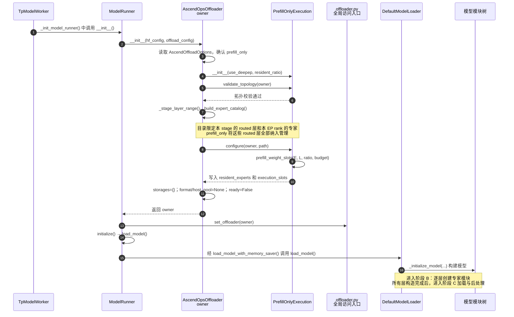

这时已经确定 `R` 和执行池所需槽位数 `S = L × R + 2 × (E - R)`，实际 Host 池及 NPU 执行池尚未创建。`set_offloader(owner)` 必须先于模型构造，因为量化方法创建专家参数时会调用 `get_offloader()`。[worker 创建 runner][init-worker-create]、[runner 创建 owner][modelrunner]、[槽位计算][slots]

#### B. 构建模型：每层参数接管与计算组件创建

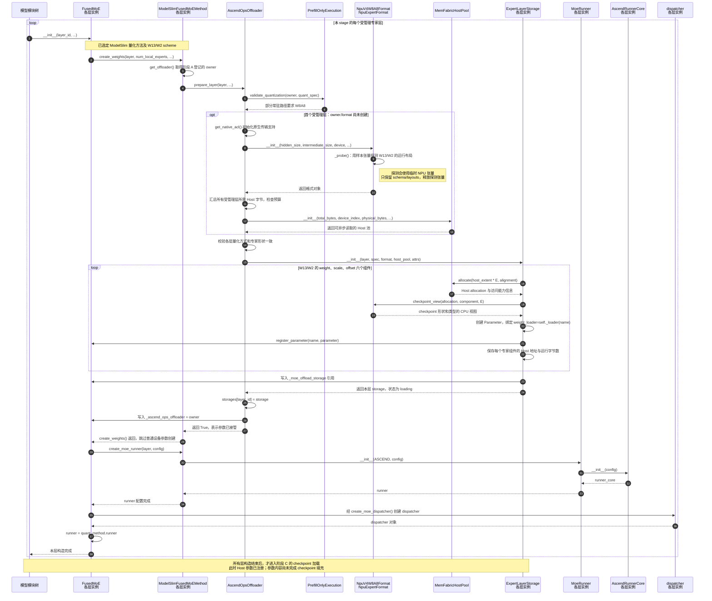

`Format` 和 Host 池在首层创建后供后续层复用；`ExpertLayerStorage`、量化方法、MoE runner、core 和 dispatcher 则按层创建。图中 dispatcher 在 AscendOps 路径对应 `AscendOpsDispatcher`；DeepEP 使用相应后端对象，hook 在阶段 D 才注册。[层接管][preparelayer]、[参数注册][storageparams]、[计算组件创建][fusedcreate]、[量化方法桥接][modelslim]

#### C. 加载 checkpoint，逐专家转换，封存 Host 主副本

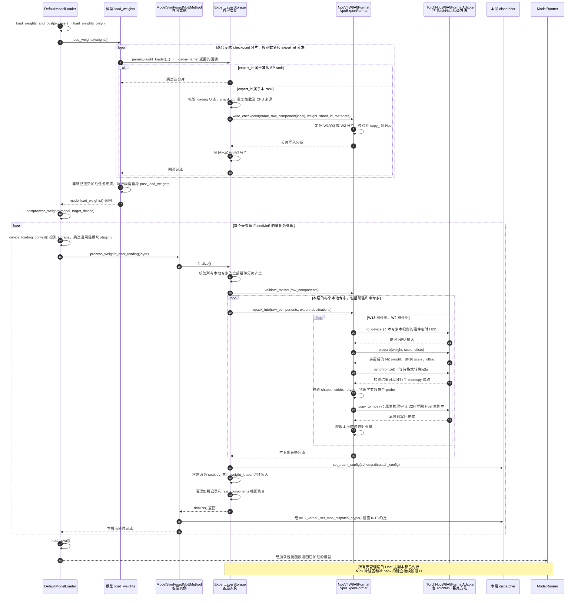

加载回调允许由线程池调度；图中表示每个分片的逻辑调用链，以及“加载全部完成后才后处理”的先后关系，不限定线程池内部的执行顺序。`finalize()` 清理的是加载期记录与视图集合，Host 主副本仍由参数、存储能力对象和池的引用保留。转换后 Host 存的是运行布局的字节，推理时预取无需再做 NZ 转换。[加载器顺序][init-default-loader]、[模型加载回调][init-weight-callback]、[逐专家转换][init-repack]、[W8A8 格式处理][init-w8-adapter]

#### D. 校验封存状态，创建执行池，填充常驻专家，准备冷专家流水线

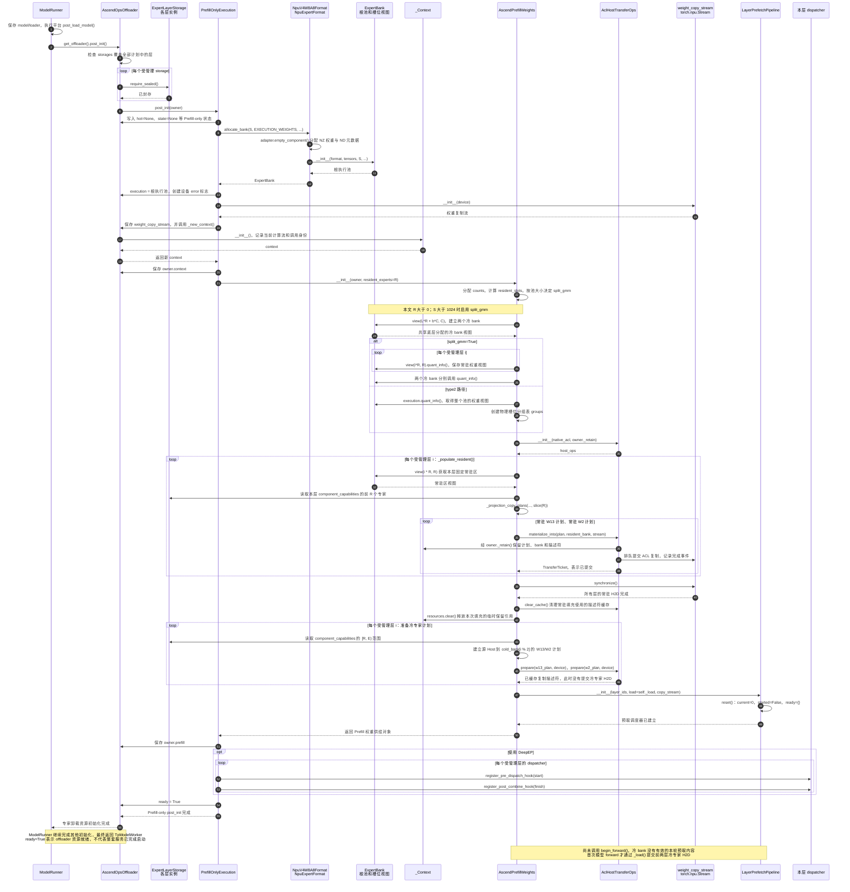

图 D 中 `C = E - R`，`b` 取 0 或 1。先决定 `split_gmm` 并建立权重视图，再创建 `host_ops` 和填充常驻区。`host_ops.prepare()` 只准备描述符，`materialize_into()` 才提交搬运。[运行资源建立][postinit]、[Prefill 构造与常驻填充][prefill]、[描述符准备][init-copy-prepare]、[复制提交][transferops]、[DeepEP hook][deepephooks]

#### 初始化完成时应具备的状态

| 对象 | 完成状态 | 后续首次 forward 的行为 |
|---|---|---|
| `AscendOpsOffloader` | `ready=True`；目录、storages、format、execution、复制流、prefill 均已建立。 | `forward_scope()` 创建新的本轮 context。 |
| 各层 `ExpertLayerStorage` | `sealed`；全部本地专家的 Host 主副本都已转换为运行布局，加载回调禁止再写。 | 作为异步复制源保留。 |
| `owner.execution` | 固定常驻区已填充；两个冷 bank 已分配。 | 冷 bank 按层交替填充和复用。 |
| `AscendPrefillWeights` | 权重视图、分组元数据、各层冷专家 W13/W2 计划及描述符均已准备。 | `_load()` 将相应计划提交到复制流。 |
| `LayerPrefetchPipeline` | `invocation_id=None`、`current=0`、`started=False`、`ready={}`。 | `begin_forward()` 登记本轮身份并提交前两层预取。 |
| `FusedMoE` 及计算组件 | storage/owner 引用、量化方法、runner/core、dispatcher 已建立；dispatcher 的 INT8 约定已设置。 | 进入 `dispatch → runner → combine`，触发逐层 offload 接入点。 |

## 5. 一次 Prefill forward 的调用关系

模型级 `forward_scope` 和逐层的 `start/acquire/retire` 操作同一个 pipeline、同一个本轮 context。`yield` 期间执行模型并触发逐层接入点。

```text
TpModelWorker.forward_batch_generation()
└─ ModelRunner.forward()
   └─ with owner.forward_scope(forward_batch):
      ├─ PrefillOnlyExecution.forward_scope(owner, batch) 进入
      │  ├─ 创建本轮 context
      │  └─ pipeline.begin_forward(context)
      │     └─ 提交前两个受管理 MoE 层的冷专家搬运
      ├─ yield：执行 ModelRunner._forward_raw()
      │  └─ 模型逐层执行，进入 FusedMoE.forward_impl()
      │     ├─ dispatcher.dispatch()
      │     │  └─ owner.start_prefill_layer() → pipeline.start()
      │     ├─ run_moe_core()
      │     │  └─ ModelSlimFusedMoEMethod.apply() → MoeRunner.run()
      │     │     └─ AscendRunnerCore.run()
      │     │        ├─ owner.prepare_weights() → prefill.weights()
      │     │        └─ _run_ffn() 或 _run_split_prefill()
      │     │           └─ 在使用冷 W13/W2 前建立相应事件依赖
      │     └─ dispatcher.combine()
      │        └─ 合并提交后 prefill.finish_layer()
      │           └─ 记录计算完成事件 → pipeline.retire()
      │              └─ 复制流等待旧读者完成后，在同一 bank 装入第 i+2 层
      ├─ yield 正常返回后：pipeline.finish_forward()、owner._check_error()
      └─ finally：等待计算/复制完成、清理本轮资源引用、pipeline.reset()
```

这里的 `i` 是受管理 MoE 层列表中的序号，可能与模型的绝对 `layer_id` 不同。常驻专家始终使用各层固定槽位；两个冷 bank 按 `i % 2` 轮转。

| 操作 | 触发位置 | 实际作用 |
|---|---|---|
| `begin_forward()` | 模型 forward 入口 | 建立本轮身份与初始流依赖，提交前两层预取。 |
| `start()` | 每层 dispatch 入口 | 校验层顺序和调用身份，设置 `started=True`；此处没有新的 H2D 提交，也不等待权重。 |
| `acquire()` | 使用冷 W13 前 | 返回 bank 序号，并让计算流等待本层 W13 复制完成事件。 |
| `wait_for_w2()` | W13/激活之后、冷 W2 计算之前 | 让计算流等待本层 W2 复制完成事件。 |
| `retire()` | 每层 combine 提交后 | 用计算完成事件约束 bank 复用，提交第 `i+2` 层，推进当前层序号。 |
| `finish_forward()` | 模型 forward 正常返回后 | 检查本轮受管理层是否全部消费；资源排空及重置在外层 `finally` 中完成。 |

`weights()` 的返回与 W13 等待有两种安排：

- `split_gmm=False`：`weights()` 内调用 `pipeline.acquire()`，建立冷 W13 依赖后返回权重视图；随后执行 FFN，并在 W2 前单独等待。
- `split_gmm=True`：`weights()` 先返回常驻权重；runner 先提交有 token 的常驻部分，再通过 `cold_weights() → acquire()` 建立冷 W13 依赖，执行冷专家部分并在冷 W2 前等待。空 token 分组会跳过对应计算。

等待的底层实现是 `compute_stream.wait_event(event)`，用于建立设备流依赖；整轮 `finally` 中的 `synchronize()` 才负责等待排队任务结束后清理本轮引用。Host 主副本、NPU 权重池和常驻权重跨 forward 保留。[权重返回与冷权重接口][prefillweights]、[runner 计算及等待位置][runnercore]、[事件等待][eventwait]、[forward_scope][scope]

### DeepEP 的接入差异

AscendOps 在 `dispatch()` 和 `combine()` 中直接调用 owner。DeepEP 在 `PrefillOnlyExecution.post_init()` 时，为每个受管理专家模块的 dispatcher 注册：

```python
layer.dispatcher.register_pre_dispatch_hook(start)
layer.dispatcher.register_post_combine_hook(finish)
```

回调分别调用 `owner.start_prefill_layer(layer_id)` 和 `owner.prefill.finish_layer(layer_id)`，共同使用上面的流水线。这里注册的是 dispatcher hook；这套 offload 调度没有通过给整个 DecoderLayer 注册 `register_forward_pre_hook/register_forward_hook` 实现。[DeepEP hook 注册][deepephooks]

## 6. 部分常驻对应的资源归属

令每层本地专家数为 `E`，常驻数 `R = int(E × prefill_resident_ratio)`，冷专家数 `C = E - R`，受管理层数为 `L`。当前实现按本地专家编号选取前 `R` 个固定常驻，执行池槽位数为：

```text
S = L × R + 2 × C

owner.storages[layer_id]：每层保留 E 个专家的 Host 主副本

owner.execution：
[第0层常驻 R] ... [第L-1层常驻 R] [冷 bank 0：C] [冷 bank 1：C]

owner.prefill：维护上述槽位的视图、复制计划和计算分组信息
owner.prefill.pipeline：维护本轮哪些层可以读、何时可以复用冷 bank
```

Host 权重的加载、封存属于 `ExpertLayerStorage`；NPU 大权重池的建立由 `PrefillOnlyExecution` 调用 format 完成并挂在 owner 上；视图及搬运计划属于 `AscendPrefillWeights`；复用时序属于 `LayerPrefetchPipeline`。这种分工也区分了“数据存在哪里”和“何时允许读取/覆盖”。[槽位计算][slots]、[资源建立][postinit]、[常驻与冷 bank 视图][prefill]

## 7. type2 前后：token 不换队，改成按槽位找权重

本节比较的是**同一次 forward 中，进入 `owner.prepare_weights()` 之前，与它返回之后**的输入，不是两个版本的程序。范围为部分常驻、`split_gmm=False`，即实际 NPU 权重池槽位数 `S <= 1024` 的 type2 路径。以 AscendOps 的 alltoallv Prefill 和非空接收为例；全空接收会跳过 FFN，超过槽位上限的 split 路径见第 5 节。

大白话理解：dispatch 和 pre-permute 已经让 token 按“交给哪个逻辑专家”排好队。type1 的计数表说“专家 0 吃几行、专家 1 吃几行……”。部分卸载后，本层的常驻专家与冷专家放在大权重池的不同位置，type2 就把这张表改为“接下来几行，去物理槽位几找权重”。**排队顺序保持，找权重的地址变得明确。**

### 7.1 输入到底变了什么

令 `M` 为本 rank 路由后参与当前 MoE 的输入行数，`E` 为每层本地专家数，`S` 为整个执行池的槽位数。`M` 包含 top-k 路由展开后的行，同一个原始 token 可以贡献多行。

| 输入 | `prepare_weights()` 前 | 返回后，进入 GMM | 这一步做了什么 |
|---|---|---|---|
| `hidden_states` | 已按本层逻辑专家分组的 `M` 行 | 同一个字段、同样的行顺序 | 没有因 type2 再搬一次或重排 token。 |
| `hidden_states_scale` | 与输入行对应的 scale（若有） | 保持对应关系 | 没有因 type2 重排 scale。 |
| `expert_tokens` | `[E]` 的每专家 token 数 | `[S, 2]` 的槽位/行数对 | 把逻辑专家映射到物理槽位，按原专家顺序紧凑写入有 token 的分组；其余项补零。 |
| `group_list_type` | `1` | `2` | 告诉 GMM 如何解释上面的表。 |
| `quant_info` | runner 原本收到的、由 `layer` 属性组装的对象 | owner 提供的 NPU **全池**权重视图，各权重组件的专家维度为 `S` | runner 用返回值替换引用；这里没有把常驻权重和冷权重拼成新 tensor。 |
| 激活步骤需要的分组信息 | 逻辑专家计数 | `owner.prefill.counts`，形状仍为 `[E]`，type1 | 独立保留逻辑计数；需要分组信息的激活核不使用物理槽位表。 |

这里的 `quant_info` 是权重及量化参数的引用集合，不是把所有组件装进一个 tensor。W13、W2 及各自的 scale/offset 使用不同组件 tensor，但共享同一套物理槽位编号。

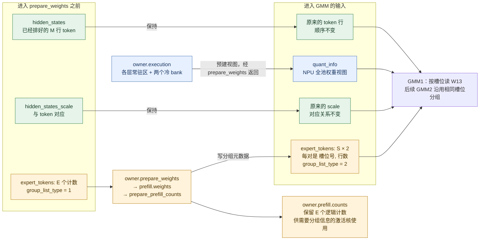

图中箭头表示字段、元数据和引用的传递，不是权重 H2D；冷权重的实际搬运见第 8 节。GMM2 接收的是 GMM1/激活产生的新数值及 scale，但沿用相同的槽位分组与行对应顺序。

对应源码的关键语句是：

```python
# AscendRunnerCore.run(): 返回值替换 quant_info；runner_input 的分组字段被更新
quant_info = owner.prepare_weights(self.config.layer.layer_id, runner_input)
x = runner_input.hidden_states
expert_tokens = runner_input.expert_tokens
group_list_type = runner_input.group_list_type

# AscendPrefillWeights.weights(): type2 分支选择并最终写回这两个字段
group_tokens, group_type = self.groups, 2
runner_input.expert_tokens, runner_input.group_list_type = group_tokens, group_type
```

注意：`quant_info` 不是 `prepare_weights()` 的输入参数；它是返回值，由 runner 接住。进入这个方法前的 token 分组来自 [alltoallv pre-permute][type2-input]；原始权重引用来自 [ModelSlim.apply][type2-original-quant]；转换及替换在 [prefill.weights][prefillweights] 和 [AscendRunnerCore.run][type2-runner]；最终参数透传到 [npu_grouped_matmul][type2-gmm]。

### 7.2 一个能逐行对上的小例子

以下是**按代码规则构造的示意规模，不是模型的实际配置或实测数据**：3 个受管理 MoE 层，每层 4 个本地专家，前 2 个常驻、后 2 个为冷专家。于是 `L=3, E=4, R=2, C=2, S=3×2+2×2=10`。当前执行第 2 个受管理层，即序号 `i=1`。

| 物理槽位 | 长期用途 | 当前层 `i=1` 如何使用 |
|---|---|---|
| `0, 1` | 第 0 层的常驻专家 0、1 | 不读。 |
| `2, 3` | 第 1 层的常驻专家 0、1 | 专家 0 读槽位 2；本例专家 1 没有 token。 |
| `4, 5` | 第 2 层的常驻专家 0、1 | 不读。 |
| `6, 7` | 冷 bank 0，轮流放偶数序号层的冷专家 | 本层不读；可用于第 2 层预取。 |
| `8, 9` | 冷 bank 1，轮流放奇数序号层的冷专家 | 本层冷专家 2、3 分别读槽位 8、9。 |

假设本层逻辑计数是 `[2, 0, 3, 1]`，输入的 6 行已经是 `[a, b, c, d, e, f]`：

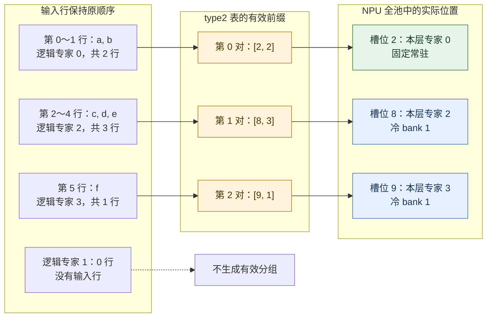

完整的分组 tensor 是：

```text
type1: expert_tokens = [2, 0, 3, 1]               # shape [4]

type2: expert_tokens = [[2, 2],                   # 前 2 行用槽位 2
                       [8, 3],                   # 接着 3 行用槽位 8
                       [9, 1],                   # 接着 1 行用槽位 9
                       [0, 0], [0, 0], [0, 0],
                       [0, 0], [0, 0], [0, 0],
                       [0, 0]]                   # shape [10, 2]，剩余 7 对为零

hidden_states       = [a, b, c, d, e, f]          # 前后相同；6 行不变成 10 行
hidden_states_scale = [sa, sb, sc, sd, se, sf]    # 有逐行 scale 时，仍一一对应
```

表的**第几行不是槽位号**，第一列里的数才是槽位号。`[8, 3]` 的意思是“下一段 3 行 token 用槽位 8”，不是“第 8 个 token 用专家 3”。`[0, 0]` 表示零行，不会要求槽位 0 参与当前计算。

源码中的映射公式为：

```text
逻辑专家 e < R：slot = i × R + e
逻辑专家 e ≥ R：slot = L × R + (i % 2) × C + (e - R)

本例：e = [0, 1, 2, 3] → slot = [2, 3, 8, 9]
      count = [2, 0, 3, 1] → 有效分组 = [[2, 2], [8, 3], [9, 1]]
```

`prepare_prefill_counts` 用 `count > 0` 选择有 token 的专家，并按逻辑专家顺序压紧分组表；它没有压紧或重排 token tensor。源码：[槽位映射及分组表生成][type2-mapping]。

`execution_slots` 因而表示 NPU 常驻区和两个冷 bank 的物理槽位容量。每个组件本来就在执行池的规范布局里；type2 让 GMM 直接寻址相隔的槽位，无需再把“本层常驻 + 本层冷专家”复制到一块临时连续权重区。**冷专家从 Host 到冷 bank 的 H2D 仍然存在**，type2 省掉的是这类额外的权重拼装需求。全池视图的建立见 [AscendPrefillWeights.__init__][type2-pool]。

另一个边界是：**稀疏计算不等于按本轮 token 挑选冷专家预取。** 当前复制计划在初始化时就按 `slice(R, None)` 建好，覆盖本层全部 `C` 个冷专家。即使某个冷专家本轮没有 token，它仍在该层的预取计划里，只是不产生有效 GMM 分组。[冷专家计划建立][copy-plans-init]

## 8. 一次 Prefill forward：copy 从哪里发起，在哪里等待

沿用第 7 节的 3 层示例。下图按真实源码调用顺序展开一次正常、非空的 Prefill forward；它是**源码流程示意，不是 NPU profiler 的实测时间线**。层号 `i=0,1,2` 均为受管理层的序号，实际函数参数传的是相应 `layer_id`。

### 8.1 从整轮 forward 到每层 GMM 的控制流

图中的“提交等待”指往设备流排入依赖，不能读成“Python 在这里等到复制完成才返回”。模型自己推进各层，pipeline 只负责权重供给和复用顺序。

```mermaid
flowchart TB
    Worker["TpModelWorker.forward_batch_generation<br/>→ ModelRunner.forward"]
    Scope["with owner.forward_scope(batch)<br/>→ PrefillOnlyExecution.forward_scope<br/>创建本轮 context"]
    Begin["pipeline.begin_forward<br/>① 计算流记录入口事件，复制流等待它<br/>② _submit(0) 和 _submit(1)<br/>提交前两层冷 W13 / W2"]
    Raw["yield → ModelRunner._forward_raw<br/>执行模型；从第 0 个受管理层开始"]
    Layer["模型推进到本层 MoE<br/>此前可以执行 attention / router 等"]
    Dispatch["FusedMoE.forward_impl → dispatcher.dispatch<br/>owner.start_prefill_layer → pipeline.start<br/>校验层顺序；随后路由 / 通信"]
    Runner["run_moe_core → ModelSlim.apply → MoeRunner.run<br/>pre-permute：整理为逻辑专家顺序<br/>→ AscendRunnerCore.run"]
    Prepare["owner.prepare_weights → prefill.weights<br/>写 type2 分组表；准备全池权重引用"]
    Wait13["pipeline.acquire<br/>计算流提交 wait_event：本层冷 W13 就绪"]
    GMM1["_run_ffn → w13_kernel.apply<br/>GMM1 读取本层常驻和冷 W13"]
    Act["SwiGLU / 激活及量化<br/>需要分组时使用逻辑计数"]
    Wait2["owner.wait_for_w2 → pipeline.wait_for_w2<br/>计算流提交 wait_event：本层冷 W2 就绪"]
    GMM2["w2_kernel.apply<br/>GMM2 读取本层常驻和冷 W2"]
    Combine["post-permute → dispatcher.combine<br/>提交返回通信及输出整理"]
    Retire["prefill.finish_layer<br/>context.record_compute_completion：记录 D_i<br/>→ pipeline.retire"]
    Refill{"还有第 i+2 个<br/>受管理层吗？"}
    Submit["_submit(i+2, reader=D_i)<br/>复制流先提交 wait_event(D_i)<br/>再向同一冷 bank 提交未来层 W13 / W2"]
    Advance["retire 完成：删除当前票据<br/>current += 1；started = False"]
    More{"还有受管理层吗？"}
    Rest["模型完成剩余计算；_forward_raw 返回<br/>finish_forward 校验层均已消费<br/>owner._check_error"]
    Drain["finally：计算流 wait_stream(复制流)<br/>记录最终事件并在 CPU synchronize<br/>清理本轮引用；pipeline.reset"]
    Worker --> Scope --> Begin --> Raw --> Layer --> Dispatch --> Runner
    Runner --> Prepare --> Wait13 --> GMM1 --> Act --> Wait2 --> GMM2 --> Combine
    Combine --> Retire --> Refill
    Refill -->|有| Submit --> Advance
    Refill -->|无| Advance
    Advance --> More
    More -->|有，模型继续下一层| Layer
    More -->|无| Rest --> Drain
    classDef copy fill:#e7f0ff,stroke:#4775b5,color:#17345e;
    classDef wait fill:#fff3db,stroke:#b78019,color:#4c3400;
    classDef compute fill:#e6f4ea,stroke:#34834b,color:#173b24;
    class Begin,Submit copy;
    class Wait13,Wait2,Retire,Drain wait;
    class GMM1,Act,GMM2 compute;
```

三个容易混淆的点：

- `begin_forward()` 在模型执行前就提交前两层；`start_prefill_layer()` 在逐层 dispatch 入口只登记和校验状态，不在那里重新搬权重，也不在那里等待权重。
- 当前 type2 分支把本层常驻和冷专家交给同一次 GMM1，因此它在 GMM1 前统一等待本层冷 W13；不会先单独计算常驻专家。先算常驻再算冷专家是 `split_gmm=True` 的另一条路径。
- `finish_layer()` 发生在 combine 已经提交之后。此时 CPU 可以继续提交未来层复制，复制流里的 `wait_event(D_i)` 保证旧层真正执行到该事件以后，才覆盖它刚用过的冷 bank。

对应入口：[ModelRunner.forward_scope 包裹点][copy-model-scope]、[策略 forward_scope][scope]、[dispatcher start / finish 接入][dispatcher]、[runner 的 GMM 与 W2 等待][copy-ffn]、[pipeline 的 begin / acquire / retire][pipeline]。

### 8.2 发起 H2D 的调用栈：计划、批量提交、完成事件

每层有两份复制计划，先 W13，后 W2。每份计划包含这个投影的权重及量化组件。计划的源是该层 Host 主副本，目的地是 `bank = i % 2` 对应的冷 bank；常驻部分在初始化时已填好，本轮不重新搬运。

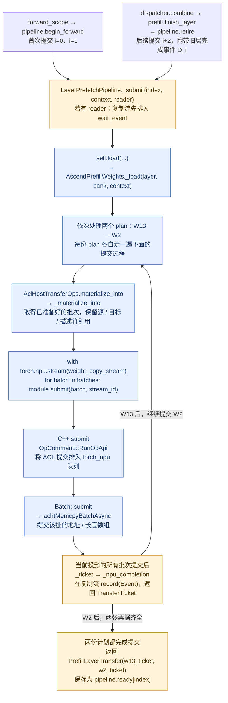

`ready[index]` 保存的是**可供等待的完成票据**；字典里有这个键，不代表 CPU 已确认 H2D 完成。W13 票据只约束 W13 计划，W2 票据约束 W2 计划；由于共享一条 FIFO 复制流，W2 事件也排在本层 W13 之后。实际使用权重前仍要在计算流插入对应的事件等待。

“是不是一个一个专家 copy”要分两层看：

| 层次 | 当前实现 |
|---|---|
| 描述要搬哪些字节 | `_projection_copy_plans()` 按“组件 → 专家”构造 `HostCopyRegion`，因此原始描述确实包含每个冷专家的切片。 |
| 整理描述符 | `AclHostTransferOps._lower()` 校验各切片；只有源和目的地址都相邻，且共享相同源 registration、目的 owner 时才合并。存在 stride/padding 时不能任意合并。 |
| 发起搬运 | 整理后的描述符按批次提交，默认每批至多 256 项；调用 `aclrtMemcpyBatchAsync`，不是 Python 对每个专家逐一 `copy_` 后等待。描述符通常已在初始化 `prepare()` 时缓存。 |
| 标记完成 | 一份投影计划的所有批次提交后，统一记录一个就绪事件。这里没有为每个专家逐个同步。批量 API 也不等于承诺硬件同时搬完所有切片。 |

`OpCommand::RunOpApi` 这层保证实际 ACL 提交遵守前面排入的等待、后面排入的完成事件的顺序；不能从“Python 调用了 submit”推断复制已执行完。源码：[复制计划构造][copy-plan-builder]、[计划预准备][init-copy-prepare]、[描述符合并和分批][copy-lower]、[复制流内提交][copy-submit]、[C++ 队列提交][copy-native-submit]、[ACL 批量调用][copy-native-batch]、[完成事件记录][copy-ready-event]。

### 8.3 把计算流与复制流放到同一张图

下面只展开 3 个受管理层的关键依赖。绿色是计算，蓝色是 H2D，橙色是等待/事件边界；实线为同一流上的先后关系，虚线为跨流必须满足的事件依赖。图不按耗时比例绘制，两个流实际能重叠多少取决于运行时耗时。

`E_begin`、`E13_i`、`E2_i`、`D_i` 是图里的事件简称，分别表示入口计算完成、本层冷 W13 就绪、本层冷 W2 就绪、本层 combine 后的计算完成；不是代码里的变量原名。

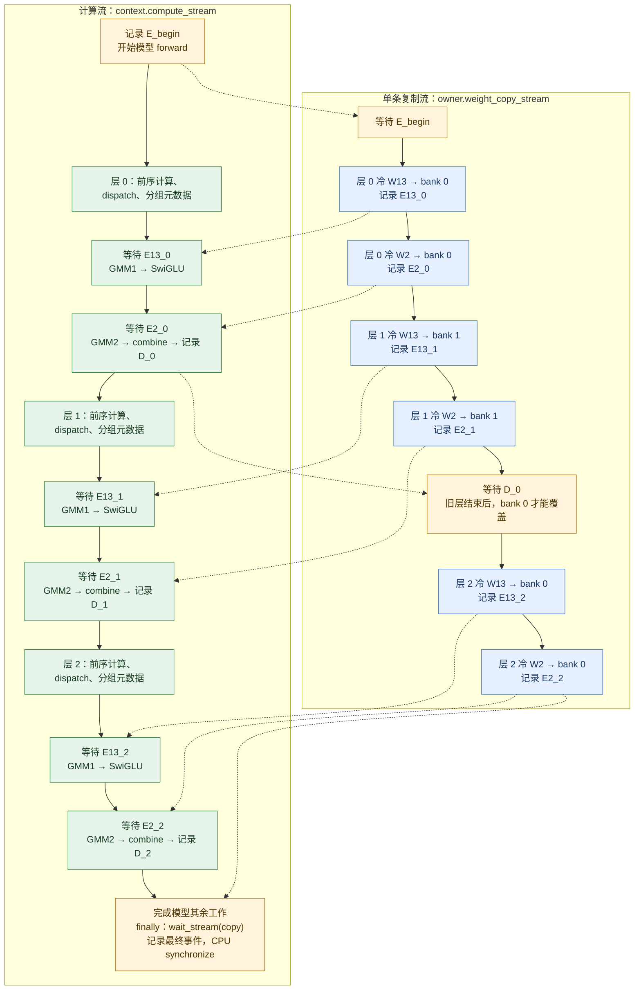

入口已把层 0、层 1 的复制排进同一条流，所以顺序是 `0.W13 → 0.W2 → 1.W13 → 1.W2`。层 0 的 combine 提交后，`retire(0)` 才追加 `wait(D_0) → 2.W13 → 2.W2`。这不是为每层另起一条 copy stream。

这样有两类重叠机会：本层 GMM1/激活可以与本层 W2 搬运重叠；当前层计算可以与下一层冷权重预取重叠。`W13` 就绪后即可开始 GMM1，不必把本层两份权重都等齐。图里的依赖只保证正确顺序，不保证运行中一定出现某段长度的重叠。

| 本轮阶段 | bank 0（槽位 6、7） | bank 1（槽位 8、9） | 谁触发 |
|---|---|---|---|
| forward 入口 | 提交层 0 冷专家 | 提交层 1 冷专家 | `begin_forward()` 的 `_submit(0/1)`。 |
| 层 0 combine 提交后 | 排入等待 `D_0`，然后装层 2 | 继续保留层 1 | `finish_layer(0) → retire(0) → _submit(2, reader)`。 |
| 层 1 combine 提交后 | 保留/完成层 2 预取 | 层 1 已消费，无层 3 可补 | `retire(1)` 只推进状态。 |
| 层 2 combine 提交后 | 层 2 已消费，无层 4 可补 | 不再使用 | `retire(2)`；最后由 scope 排空本轮任务。 |

上表的“提交”不等于“已经复制完成”，何时能读仍由图中的就绪事件保证。各层常驻槽位 0～5 在整个过程中保持自己的权重，不参加双 bank 轮转。

### 8.4 每个等待点的具体调用栈和源码

| 等待点 | 从哪里一路调用下来 | 最终动作与含义 |
|---|---|---|
| forward 入口，让复制尊重先前计算 | `forward_scope → begin_forward → context.record_compute_completion → completion.wait_on(copy_stream)` | 计算流记录 `E_begin`，复制流 `wait_event(E_begin)`。 |
| GMM1 前等冷 W13 | `AscendRunnerCore.run → owner.prepare_weights → prefill.weights → pipeline.acquire → ready[current].w13.completion.wait_on(compute_stream)` | 计算流 `wait_event(E13_i)`，后续 GMM1 才能读本层冷 W13。 |
| GMM2 前等冷 W2 | `_run_ffn → wait_for_w2 回调 → owner.wait_for_w2 → pipeline.wait_for_w2 → ready[current].w2.completion.wait_on(compute_stream)` | 计算流 `wait_event(E2_i)`，后续 GMM2 才能读本层冷 W2。 |
| 复用旧层冷 bank | `dispatcher.combine → prefill.finish_layer → record_compute_completion → pipeline.retire → _submit(i+2, reader) → reader.completion.wait_on(copy_stream)` | 复制流 `wait_event(D_i)`，禁止提前覆盖旧层还可能读取的字节。 |
| 整轮结束后清理 | `forward_scope.finally → compute_stream.wait_stream(weight_copy_stream) → record_compute_completion().completion.synchronize()` | 先把复制流末尾并入计算流，再由 CPU 等最终事件；完成后清理引用、重置 pipeline。 |

最底层代码非常直接：

```python
# EventCompletion：按需向某条设备流插入依赖
def wait_on(self, stream):
    stream.wait_event(self.event)

# 整轮收尾使用：CPU 等待该事件真正完成
def synchronize(self):
    self.event.synchronize()
```

这区分的是**权重预取链路中的设备依赖和 CPU 等待**，不意味着整个 forward 的其他部分没有 CPU 同步；例如 dispatch 的计数读取、通信及 `_check_error()` 仍有自己的行为。

源码定位：[入口及初始提交][copy-begin]、[W13 acquire 与 W2 wait][copy-waits]、[finish_layer 记录旧读者事件][copy-finish-layer]、[retire 及 bank 复用][copy-retire]、[计算流事件创建][copy-compute-event]、[EventCompletion 的两种等待][eventwait]、[scope 的最终排空][scope]。

## 9. 五个权重管理对象：初始化与 forward 时序

本节把前文分散的调用关系集中到两张图中，范围为 **`prefill_only` + 每层部分常驻 + DeepEP normal + type2**。令 `E` 为每层本地专家数，`R > 0` 为每层固定常驻数，`C = E - R`，`L` 为本 rank 受管理层数，物理槽位数为 `S = L × R + 2 × C`；这里取 `split_gmm=False`，即当前实现中的 `S <= 1024`。`i` 始终表示受管理层的顺序编号，不是模型的绝对 `layer_id`。

| 对象 | 管什么 |
|---|---|
| `MemFabricHostPool` | Host 内存本身、地址映射、注册和生命周期。 |
| `ExpertLayerStorage` | 这块内存中，本层专家权重的加载、布局转换和封存。 |
| `ExpertBank` | NPU 权重内存和物理 slot，包括根池与共享底层内存的视图。 |
| `AscendPrefillWeights` | 从哪个 Storage 搬到哪个 Bank，以及如何把权重交给计算。 |
| `LayerPrefetchPipeline` | 何时提交搬运、何时允许读取和覆盖。 |

两张图都额外画出调用入口和 `AclHostTransferOps`，用于说明谁触发这些对象、谁实际提交复制。图中的 Host / Bank 内存读写箭头表示数据访问；复制和 GMM 由相应调用方提交，内存对象本身不执行这些算子。

### 9.1 模型初始化：先准备 Host 主副本，再建立 NPU 供权资源

“初始化调用方”合并表示 `ModelRunner`、`AscendOpsOffloader`、`PrefillOnlyExecution` 以及格式适配层的相关调用；展开到各入口的时序见第 4 节。

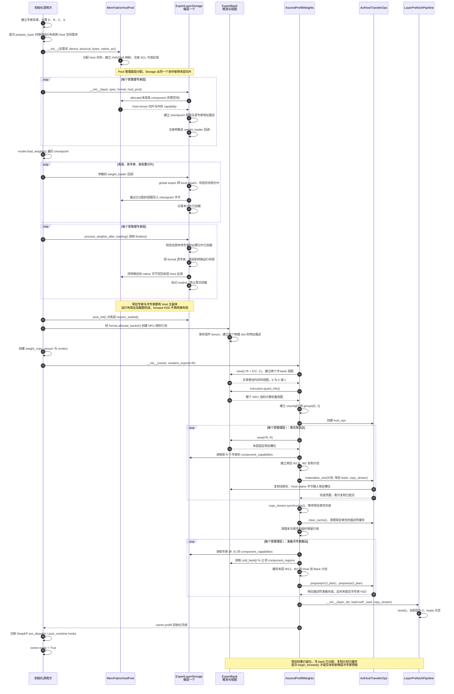

初始化后的 Host 主副本、NPU 根池和常驻权重跨 forward 保留。冷 bank 的“地址已经存在”和“本轮权重已经搬好”是两个不同状态；后者由每轮的复制事件保证。[Host 池][five-host-pool]、[Storage 加载与封存][storage]、[运行资源建立][postinit]、[Prefill 视图与复制计划][prefill]、[DeepEP hook 注册][deepephooks]

### 9.2 一次 Prefill forward：初始预取、按层读取、隔层复用

“Forward 调用方”合并表示 `ModelRunner`、执行策略、DeepEP dispatcher、MoE runner 和 owner 的转发调用。**图的上下顺序表示 CPU 调用与提交顺序，不代表设备上的 H2D、GMM、combine 已经执行完成。** `wait_event` 为后续设备任务建立依赖；标出的 `synchronize` 才是 CPU 等待完成。

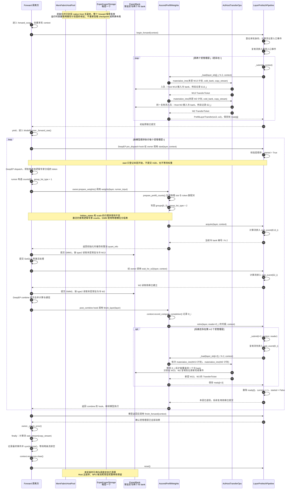

图中 GMM / 激活展示有 token 的计算路径；空 token 的处理由 runner 决定。冷专家复制计划在初始化时已覆盖本层全部 `C` 个冷专家，不会因为某个专家本轮 token 数为 0 而自动缩减。

这里有两个方向相反的依赖：

- **读取前等搬好**：`acquire()` / `wait_for_w2()` 让计算流等待复制事件，随后 GMM 才能读取相应冷权重。
- **覆盖前等读完**：`finish_layer() → retire() → _submit(reader)` 让复制流等待 combine 提交之后记录的计算事件，随后才能覆盖同一个冷 bank。第 `i+1` 层已经预取，这里补的是第 `i+2` 层。

`finish_layer()` 的触发点是 **combine 已提交之后**；CPU 在这里记录事件和提交等待，不必先等 combine 在设备上实际完成。因此图中后续提交动作可以发生在设备仍执行前面 GMM 的时候。`begin_forward()` 则由 `forward_scope` 直接调用，并非 dispatcher hook。[整轮 scope][scope]、[初始提交][copy-begin]、[W13/W2 等待][copy-waits]、[combine 后退役][copy-finish-layer]、[bank 复用][copy-retire]、[复制提交][copy-submit]、[GMM 与激活][copy-ffn]

[worker]: /Users/yaobao/Desktop/Workspace-Ascend/sglang-moe-offload-npu/源哥的优化分支/simplify/python/sglang/srt/managers/tp_worker.py:282
[modelrunner]: /Users/yaobao/Desktop/Workspace-Ascend/sglang-moe-offload-npu/源哥的优化分支/simplify/python/sglang/srt/model_executor/model_runner.py:506
[fused]: /Users/yaobao/Desktop/Workspace-Ascend/sglang-moe-offload-npu/源哥的优化分支/simplify/python/sglang/srt/layers/moe/fused_moe_triton/layer.py:339
[baseoffloader]: /Users/yaobao/Desktop/Workspace-Ascend/sglang-moe-offload-npu/源哥的优化分支/simplify/python/sglang/srt/utils/offloader.py:33
[offloader]: /Users/yaobao/Desktop/Workspace-Ascend/sglang-moe-offload-npu/源哥的优化分支/simplify/python/sglang/srt/offloading/moe/npu/ascend_ops.py:76
[storage]: /Users/yaobao/Desktop/Workspace-Ascend/sglang-moe-offload-npu/源哥的优化分支/simplify/python/sglang/srt/offloading/moe/npu/format.py:331
[strategy]: /Users/yaobao/Desktop/Workspace-Ascend/sglang-moe-offload-npu/源哥的优化分支/simplify/python/sglang/srt/offloading/moe/npu/execution_mode.py:84
[prefill]: /Users/yaobao/Desktop/Workspace-Ascend/sglang-moe-offload-npu/源哥的优化分支/simplify/python/sglang/srt/offloading/moe/npu/prefill.py:151
[pipeline]: /Users/yaobao/Desktop/Workspace-Ascend/sglang-moe-offload-npu/源哥的优化分支/simplify/python/sglang/srt/offloading/moe/npu/prefill.py:65
[preparelayer]: /Users/yaobao/Desktop/Workspace-Ascend/sglang-moe-offload-npu/源哥的优化分支/simplify/python/sglang/srt/offloading/moe/npu/ascend_ops.py:262
[storageparams]: /Users/yaobao/Desktop/Workspace-Ascend/sglang-moe-offload-npu/源哥的优化分支/simplify/python/sglang/srt/offloading/moe/npu/format.py:370
[context]: /Users/yaobao/Desktop/Workspace-Ascend/sglang-moe-offload-npu/源哥的优化分支/simplify/python/sglang/srt/offloading/moe/npu/ascend_ops.py:52
[postinit]: /Users/yaobao/Desktop/Workspace-Ascend/sglang-moe-offload-npu/源哥的优化分支/simplify/python/sglang/srt/offloading/moe/npu/execution_mode.py:248
[modelslim]: /Users/yaobao/Desktop/Workspace-Ascend/sglang-moe-offload-npu/源哥的优化分支/simplify/python/sglang/srt/layers/quantization/modelslim/modelslim.py:544
[fusedcreate]: /Users/yaobao/Desktop/Workspace-Ascend/sglang-moe-offload-npu/源哥的优化分支/simplify/python/sglang/srt/layers/moe/fused_moe_triton/layer.py:597
[moerunner]: /Users/yaobao/Desktop/Workspace-Ascend/sglang-moe-offload-npu/源哥的优化分支/simplify/python/sglang/srt/layers/moe/moe_runner/runner.py:240
[runnercore]: /Users/yaobao/Desktop/Workspace-Ascend/sglang-moe-offload-npu/源哥的优化分支/simplify/python/sglang/srt/layers/moe/moe_runner/ascend.py:247
[dispatcher]: /Users/yaobao/Desktop/Workspace-Ascend/sglang-moe-offload-npu/源哥的优化分支/simplify/python/sglang/srt/layers/moe/token_dispatcher/ascend_ops.py:177
[format]: /Users/yaobao/Desktop/Workspace-Ascend/sglang-moe-offload-npu/源哥的优化分支/simplify/python/sglang/srt/offloading/moe/npu/format.py:70
[bank]: /Users/yaobao/Desktop/Workspace-Ascend/sglang-moe-offload-npu/源哥的优化分支/simplify/python/sglang/srt/offloading/moe/npu/format.py:279
[transferops]: /Users/yaobao/Desktop/Workspace-Ascend/sglang-moe-offload-npu/源哥的优化分支/simplify/python/sglang/srt/offloading/moe/npu/native_acl.py:349
[loaderpost]: /Users/yaobao/Desktop/Workspace-Ascend/sglang-moe-offload-npu/源哥的优化分支/simplify/python/sglang/srt/model_loader/loader.py:1085
[loadingcontext]: /Users/yaobao/Desktop/Workspace-Ascend/sglang-moe-offload-npu/源哥的优化分支/simplify/python/sglang/srt/model_loader/loader.py:158
[prefillweights]: /Users/yaobao/Desktop/Workspace-Ascend/sglang-moe-offload-npu/源哥的优化分支/simplify/python/sglang/srt/offloading/moe/npu/prefill.py:301
[eventwait]: /Users/yaobao/Desktop/Workspace-Ascend/sglang-moe-offload-npu/源哥的优化分支/simplify/python/sglang/srt/offloading/transfer.py:49
[scope]: /Users/yaobao/Desktop/Workspace-Ascend/sglang-moe-offload-npu/源哥的优化分支/simplify/python/sglang/srt/offloading/moe/npu/execution_mode.py:300
[deepephooks]: /Users/yaobao/Desktop/Workspace-Ascend/sglang-moe-offload-npu/源哥的优化分支/simplify/python/sglang/srt/offloading/moe/npu/execution_mode.py:284
[slots]: /Users/yaobao/Desktop/Workspace-Ascend/sglang-moe-offload-npu/源哥的优化分支/simplify/python/sglang/srt/offloading/moe/npu/options.py:55

[init-worker-create]: /Users/yaobao/Desktop/Workspace-Ascend/sglang-moe-offload-npu/源哥的优化分支/simplify/python/sglang/srt/managers/tp_worker.py:486
[init-default-loader]: /Users/yaobao/Desktop/Workspace-Ascend/sglang-moe-offload-npu/源哥的优化分支/simplify/python/sglang/srt/model_loader/loader.py:1002
[init-weight-callback]: /Users/yaobao/Desktop/Workspace-Ascend/sglang-moe-offload-npu/源哥的优化分支/simplify/python/sglang/srt/models/deepseek_common/deepseek_weight_loader.py:440
[init-repack]: /Users/yaobao/Desktop/Workspace-Ascend/sglang-moe-offload-npu/源哥的优化分支/simplify/python/sglang/srt/offloading/moe/npu/format.py:198
[init-w8-adapter]: /Users/yaobao/Desktop/Workspace-Ascend/sglang-moe-offload-npu/源哥的优化分支/simplify/python/sglang/srt/offloading/moe/npu/w8a8_format.py:17
[init-copy-prepare]: /Users/yaobao/Desktop/Workspace-Ascend/sglang-moe-offload-npu/源哥的优化分支/simplify/python/sglang/srt/offloading/moe/npu/native_acl.py:239

[type2-input]: /Users/yaobao/Desktop/Workspace-Ascend/sglang-moe-offload-npu/源哥的优化分支/simplify/python/sglang/srt/layers/moe/moe_runner/ascend.py:605
[type2-original-quant]: /Users/yaobao/Desktop/Workspace-Ascend/sglang-moe-offload-npu/源哥的优化分支/simplify/python/sglang/srt/layers/quantization/modelslim/modelslim.py:620
[type2-runner]: /Users/yaobao/Desktop/Workspace-Ascend/sglang-moe-offload-npu/源哥的优化分支/simplify/python/sglang/srt/layers/moe/moe_runner/ascend.py:258
[type2-gmm]: /Users/yaobao/Desktop/Workspace-Ascend/sglang-moe-offload-npu/源哥的优化分支/simplify/python/sglang/srt/hardware_backend/npu/moe/matmul.py:35
[type2-mapping]: /Users/yaobao/Desktop/Workspace-Ascend/sglang-moe-offload-npu/源哥的优化分支/simplify/python/sglang/srt/offloading/moe/npu/small_batch_kernels.py:62
[type2-pool]: /Users/yaobao/Desktop/Workspace-Ascend/sglang-moe-offload-npu/源哥的优化分支/simplify/python/sglang/srt/offloading/moe/npu/prefill.py:169
[copy-plans-init]: /Users/yaobao/Desktop/Workspace-Ascend/sglang-moe-offload-npu/源哥的优化分支/simplify/python/sglang/srt/offloading/moe/npu/prefill.py:215
[copy-model-scope]: /Users/yaobao/Desktop/Workspace-Ascend/sglang-moe-offload-npu/源哥的优化分支/simplify/python/sglang/srt/model_executor/model_runner.py:1902
[copy-ffn]: /Users/yaobao/Desktop/Workspace-Ascend/sglang-moe-offload-npu/源哥的优化分支/simplify/python/sglang/srt/layers/moe/moe_runner/ascend.py:353
[copy-plan-builder]: /Users/yaobao/Desktop/Workspace-Ascend/sglang-moe-offload-npu/源哥的优化分支/simplify/python/sglang/srt/offloading/moe/npu/prefill.py:25
[copy-lower]: /Users/yaobao/Desktop/Workspace-Ascend/sglang-moe-offload-npu/源哥的优化分支/simplify/python/sglang/srt/offloading/moe/npu/native_acl.py:307
[copy-submit]: /Users/yaobao/Desktop/Workspace-Ascend/sglang-moe-offload-npu/源哥的优化分支/simplify/python/sglang/srt/offloading/moe/npu/native_acl.py:381
[copy-native-submit]: /Users/yaobao/Desktop/Workspace-Ascend/sglang-moe-offload-npu/源哥的优化分支/simplify/python/sglang/srt/offloading/moe/npu/native/acl_batch.cpp:21
[copy-native-batch]: /Users/yaobao/Desktop/Workspace-Ascend/sglang-moe-offload-npu/源哥的优化分支/simplify/python/sglang/srt/offloading/moe/npu/native/acl_batch.h:95
[copy-ready-event]: /Users/yaobao/Desktop/Workspace-Ascend/sglang-moe-offload-npu/源哥的优化分支/simplify/python/sglang/srt/offloading/moe/npu/transfer.py:389
[copy-begin]: /Users/yaobao/Desktop/Workspace-Ascend/sglang-moe-offload-npu/源哥的优化分支/simplify/python/sglang/srt/offloading/moe/npu/prefill.py:89
[copy-waits]: /Users/yaobao/Desktop/Workspace-Ascend/sglang-moe-offload-npu/源哥的优化分支/simplify/python/sglang/srt/offloading/moe/npu/prefill.py:121
[copy-finish-layer]: /Users/yaobao/Desktop/Workspace-Ascend/sglang-moe-offload-npu/源哥的优化分支/simplify/python/sglang/srt/offloading/moe/npu/prefill.py:366
[copy-retire]: /Users/yaobao/Desktop/Workspace-Ascend/sglang-moe-offload-npu/源哥的优化分支/simplify/python/sglang/srt/offloading/moe/npu/prefill.py:132
[copy-compute-event]: /Users/yaobao/Desktop/Workspace-Ascend/sglang-moe-offload-npu/源哥的优化分支/simplify/python/sglang/srt/offloading/moe/npu/ascend_ops.py:68
[five-host-pool]: /Users/yaobao/Desktop/Workspace-Ascend/sglang-moe-offload-npu/源哥的优化分支/simplify/python/sglang/srt/offloading/moe/npu/storage.py:33
