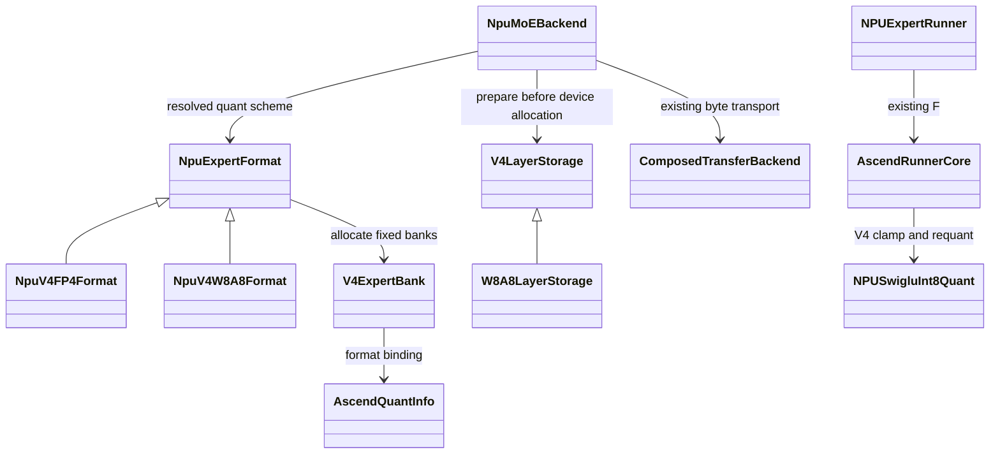

# DeepSeek V4 Flash ModelSlim W8A8 主模型适配

日期：2026-10-22。适配基线：`feat/moe-offload-dev-1022` 的 NPU offload 框架。
本次范围是普通 prefill/decode 主模型；DSpark、draft/verify 和并发 forward 保持不支持。
完整 decode graph 仍是硬件验收要求，没有 eager decode 退路。

## 权重依据与确认事项

本机参考目录为 `/Users/yaobao/Desktop/Workspace-Ascend/weights/Deepseek-v4-flash`。
目录提供配置、量化配方、量化描述和分片索引，没有实际的 75 个 safetensors 分片。
因此本次可确认配置和名称，不能声称已核验实际 tensor header、数值或 A5 性能。

- 主模型 43 层，每层 256 routed experts，top-k=6，H=4096，I=2048。
- 前三层 Hash MoE 与 shared experts 常驻，其余 40 层可卸载。
- 全部主模型 routed checkpoint 分量均声明为 `W8A8_DYNAMIC`。
- 每专家有 w1/w3/w2 的 weight、weight_scale、weight_offset，共九项。
- 配方声明权重为 per-channel 对称 INT8，激活为 per-token 对称 INT8。
- config.json 保留 expert_dtype=fp4，但实际量化类型来自 quant_model_description.json。
- swiglu_limit=10；不能用普通无 clamp 的 SwiGLU 替换。
- 用户已确认 QuaRot 折叠进导出权重，推理无需额外旋转；不读取 optional/quarot.safetensors。
- 用户已确认本次关闭 DSpark；主模型 loader 跳过 mtp.0/1/2 权重。

参考元数据 SHA256 前 16 位：config `6c6cdc4a47e00e41`；量化描述
`4838a071aa329233`；权重索引 `fe34647052b65127`。索引声明总字节数
313349893880（约 291.83 GiB，含常驻部分与 draft，不等于 offload host 池大小）。

## 从原框架生长



FusedMoE 的权重创建入口统一调用 backend.prepare_expert_weights。
FP4 与 ModelSlim 不再各自维护一套 offload 拦截。没有绑定该接口时沿用原来的
quant_method.create_weights；旧 V2 与普通常驻加载保持原路径。

选择依据是已解析的 quant method：原生 FP4，或 ModelSlimFusedMoEMethod 且 W13/W2
均为 ModelSlimW8A8Int8MoE。其他 ModelSlim 方案不能仅凭外层类名获得支持。
同一个 rank 的可卸载层必须具有相同格式和尺寸，继续使用统一专家 slot。

## Slot、主机布局和加载

运行 bundle 包含六项：w13/w2 的 weight、weight_scale、weight_offset。
Checkpoint 的 gate/up 权重及各自 scale/offset 沿输出通道合入 W13，down 保持 W2。

| 分量 | checkpoint 组装形状（E 个专家） | 运行逻辑形状 | 运行 dtype |
| --- | --- | --- | --- |
| w13_weight | [E, 2I, H] | [E, H, 2I]，NZ | INT8 |
| w2_weight | [E, H, I] | [E, I, H]，NZ | INT8 |
| w13_weight_scale | [E, 2I, 1] | [E, 2I]，ND | BF16 |
| w2_weight_scale | [E, H, 1] | [E, H]，ND | BF16 |
| w13_weight_offset | [E, 2I, 1] | [E, 2I]，ND | FP32 |
| w2_weight_offset | [E, H, 1] | [E, H]，ND | FP32 |

物理大小由单专家 NPU probe 确认；bank 的容量、stride、每专家物理间距必须与 probe
一致。W8A8 是先 transpose/contiguous 再 npu_format_cast；FP4 原路径是 cast 后的
transpose view，两者不能共用错误的 bank 构造顺序。

Host pool 是单份已注册的 master。各分量每专家预留
max(对齐后的 checkpoint bytes, runtime physical bytes)。scale 在 host 中按 FP32
组装，最终 BF16 数据写入同一预留范围，留下的 padding 也计入 host 池容量；
hot/execution bank 只分配 runtime 字节。不存在第二份全量 raw/runtime master。

加载期只在 NPU 上转换一个专家的一个投影；输入、转换输出、转置暂存及 allocator
峰值受 workspace_limit_bytes 管理。实际峰值仍需实机测量。主机 checkpoint 迭代器
原有 shard 缓冲也应计入部署 RAM，不由 graph 生命周期保活。

loader 接受 INT8 [out,in] 权重及 FP32/BF16/FP16 的通道 scale/offset，通道 metadata
可为 [N] 或 [N,1]。有界 host 参数统一存储成 FP32 metadata；其余 shape/dtype 拒绝。
所有 scale 必须有限且非负。offset 必须有限且全零：现有 W8A8 GMM 未实现非零 offset
语义，不能只搬运 offset 却忽略其计算含义。常驻 W8A8 MoE 也执行零 offset 校验。

每个本地专家九项全部加载后才能 finalize；重复项、非法 ID、缺失项和不兼容 shape
报错，其他 EP rank 的专家跳过。格式转换失败使 master 进入不可重试状态，防止把
已转换的 NZ/BF16 内容重新解释成 checkpoint 数据。finalize 成功后冻结 host master。

## 执行与 graph

所有 W8A8 offload 层以及常驻 Hash MoE 层使用 BF16 EP payload。在每次 W13 输入处
调用现有 W8A8 per-token dynamic quant；不复用 MXFP8 dispatch 配置，也不依赖 A5 的
FP8 通信选项恰好表示 INT8。W13/W2 kernel、dispatch-once/waves、缓存状态和
ACL/MemFabric 字节搬运沿用既有实现。

V4 activation 为 silu(gate.clamp(max=10)) * up.clamp(-10,10)，然后做 per-token
INT8 dynamic quant；复用已有 npu_clipped_swiglu(alpha=1,bias=0,interleaved=False)。
先用设备 group counts 屏蔽 GMM 未写入的 padding 行，避免 NaN
进入量化。count 与 mask 保持设备 tensor；没有 .item/.tolist 或 replay 中的 Python
路由选择。此 activation 也用于常驻 W8A8 路径，数值基线与 offload 保持一致。

每次传输覆盖全部六分量后才产生 weights_ready。ready/read_done、generation、
graph lease、snapshot、原 slot 恢复仍由原框架控制；W8A8 没有私有热缓存或异步
权重副本。模式切换只改变资源使用方式，不在 graph replay 时切换量化格式。

## 内存与启动

主权重每专家 3HI=24 MiB；全部可卸载主权重为 240 GiB，各 rank 除以 EP size。
忽略 NZ padding 时，BF16 scales 和 FP32 offsets 后约 24.046875 MiB/专家；
host 中保留 FP32 scale 空间约 24.0625 MiB/专家。以 probe 和实际分配 ledger 为准。
cache_ratio、execution_slots、host_pool_gib 都是每 rank 配置，不能照搬 FP4 的预算。
非零 cache_ratio 默认按层初始化，无需离线 profile/model ID；可选 profile 只影响层内排序。

```bash
MODEL_PATH=/path/to/complete/Deepseek-v4-flash \
MOE_OFFLOAD_CONFIG=/path/to/w8a8-offload.json \
  bash scripts/launch_moe_offload_npu.sh --dry-run
```

launcher 自动识别 quant_model_description.json，选择 --quantization modelslim，
并关闭 FP4 experts 标志；MOE_EXPERT_FORMAT=w8a8 可显式核验。fp4 使用原启动参数。
loader 识别 quant_model_weights.safetensors.index.json 以检查分片完整性。
本机参考目录只有 metadata，不能直接启动实际推理；需在目标机提供完整分片。

## 验证状态与目标机验收

CPU 测试覆盖原生边界替身下的 typed load、gate/up 合并、实际字节回写、BF16/FP32
物理间距、host padding 计费、bank view/QuantInfo、EP 过滤、缺失/重复/非法分量、
非零 offset 拒绝、失败后 master 保护、动态 group counts 与 NaN padding、启动参数。
格式转换边界用 CPU tensor 替身，不能证明真实 NZ、CANN 算子或 HCCL 正确性。

硬件尚待验收：

1. 完整分片 dtype/shape、zero offset、原生 format probe 及单专家 byte roundtrip。
2. W8A8 常驻单层和 offload 单层对照，包含超出 clamp 的 gate/up 输入；校验整模型输出。
3. cache_ratio=0 与非零热池，hit D2D/miss H2D、六分量 ready 和原 slot 恢复。
4. A5 双卡及目标 TP+EP，空 rank、空组、尾波、padding 和全部 miss。
5. 同一完整 decode graph 多次改变输入/路由、多个 bucket、长时换入及 prefill/decode 交替。
6. 初始化与 graph allocator 峰值、host 实际保留、H2D/D2D 流量和端到端性能。

CPU 回归使用 Python 3.10 / PyTorch 2.9.1，通过 188 项 offloading 单元测试；
测试进程仅将 sglang 顶层设为 namespace，绕过本机未安装的 serving 可选依赖。
包含实际 Bash launcher 和 fake server 的脚本测试需要允许 /dev/fd 日志重定向。
另外通过 bash -n、Python AST 检查和本地 metadata 的 W8A8 dry-run。
本文件不声明完成 A5 硬件验收。

完整依赖环境的 CPU 测试命令：

```bash
PYTHONPATH=python python -m unittest discover -s test/registered/unit/offloading -p 'test_*.py'
bash -n scripts/launch_moe_offload_npu.sh
```

本机 namespace bootstrap 与公共说明的 CPU 验证方式一致，未替换 production CPU
搬运路径；native API、设备分配、通信及动态量化仅在测试代码中提供替身。
